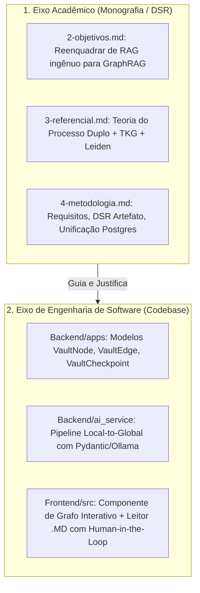
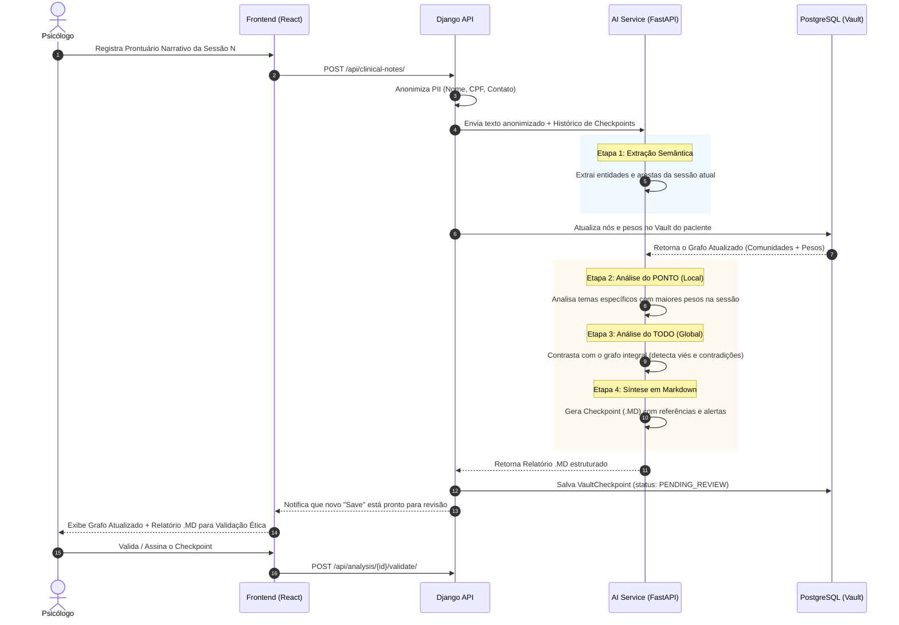

# Plano Arquitetural e Metodológico: Vault Clínico Pessoal com GraphRAG (Local-to-Global) e Checkpoints em Markdown

Este documento formaliza a integração da metáfora do **"Vault Cognitivo (Cofre) do Paciente"** com a arquitetura de **GraphRAG Hierárquico (*Local-to-Global*)**, **Grafos de Conhecimento Temporal (TKG)** e **Checkpoints Auditáveis ("Saves de Jogo" em Markdown)** no projeto de TCC **AELO**.

---

## 1. Mapeamento Estratégico: Onde Aplicar no Projeto

Para maximizar a eficácia acadêmica e técnica, a aplicação ocorre em dois eixos complementares:



---

### Eixo 1: Na Documentação e Escrita Acadêmica do TCC

| Arquivo no TCC | Seção Específica | Alteração Proposta e Justificativa |
| :--- | :--- | :--- |
| [2-objetivos.md](file:///c:/Users/erikh/OneDrive/Área%20de%20Trabalho/projects/TCC/1%20-%20TCC/wiki/tcc/2-objetivos.md) | **Objetivo 2.2 (Item 2 e 3)** | Atualizar o objetivo de *"camada de IA baseada em RAG tradicional"* para *"arquitetura de GraphRAG Hierárquico e Grafos de Conhecimento Temporal (TKG) para raciocínio longitudinal e sumarização assistida"*. |
| [3-referencial.md](file:///c:/Users/erikh/OneDrive/Área%20de%20Trabalho/projects/TCC/1%20-%20TCC/wiki/tcc/3-referencial.md) | **Seção 3.2 (IA Generativa e RAG)** | Substituir a menção a banco vetorial isolado (ChromaDB/FAISS) pela fundamentação do **GraphRAG unificado em PostgreSQL (pgvector)**, explicando como a busca vetorial simples falha no raciocínio de múltiplos saltos (*multi-hop reasoning*) em históricos clínicos longos. |
| [3-referencial.md](file:///c:/Users/erikh/OneDrive/Área%20de%20Trabalho/projects/TCC/1%20-%20TCC/wiki/tcc/3-referencial.md) | **Seção 3.3 (Inteligência Aumentada)** | Introduzir a **Teoria do Processo Duplo de Daniel Kahneman (Sistema 1 vs. Sistema 2)** para explicar a análise *"Ponto vs. Todo"*: combate o **Viés de Ancoragem (*Anchoring Bias*)** e o **Viés de Confirmação** na prática diagnóstica. |
| [3-referencial.md](file:///c:/Users/erikh/OneDrive/Área%20de%20Trabalho/projects/TCC/1%20-%20TCC/wiki/tcc/3-referencial.md) | **Seção 3.4 (Explicabilidade / LGPD)** | Fundamentar o **Log Principal / "Save de Jogo" em Markdown** como garantia do **Artigo 20 da LGPD** (Direito à Explicação): cada afirmativa do sumário possui rastreabilidade com nós de origem (*proveniência topológica*). |
| [4-metodologia.md](file:///c:/Users/erikh/OneDrive/Área%20de%20Trabalho/projects/TCC/1%20-%20TCC/wiki/tcc/4-metodologia.md) | **4.1 Requisitos Funcionais** | **RF03**: Sumarização e Mapeamento de Relações com Pesos no Vault do Paciente.<br>**RF06**: Geração de Checkpoints em Markdown ("Saves") com histórico cumulativo e assinatura obrigatória do psicólogo (*Resolução CFP nº 009/2024*). |
| [4-metodologia.md](file:///c:/Users/erikh/OneDrive/Área%20de%20Trabalho/projects/TCC/1%20-%20TCC/wiki/tcc/4-metodologia.md) | **4.2.3 Camada de Persistência** | Unificação da infraestrutura: em vez de dois bancos (PostgreSQL relacional + ChromaDB separado), utilizar o **PostgreSQL Unificado** com `pgvector` e tabelas relacionais de Grafo, reduzindo sobrecarga operacional e riscos de dessincronização em ambiente local de saúde. |

---

### Eixo 2: Na Base de Código Existente

| Componente | Arquivo / Diretório Alvo | O que implementar / estender |
| :--- | :--- | :--- |
| **Modelos de Dados** | [Backend/apps/ai_analysis/models.py](file:///c:/Users/erikh/OneDrive/Área%20de%20Trabalho/projects/TCC/Backend/apps/ai_analysis/models.py) | Criar os modelos `VaultNode` (nós com embedding), `VaultEdge` (arestas com peso e tipo de relação) e `VaultCheckpoint` (relatório em Markdown com validação humana). |
| **Pipeline de Anonimização** | [Backend/services/security/anonymization.py](file:///c:/Users/erikh/OneDrive/Área%20de%20Trabalho/projects/TCC/Backend/services/security/anonymization.py) | Manter o anonimizador ativo antes do envio para o extrator de entidades, garantindo que o cofre de conhecimento não armazene PII não mascarada. |
| **Microsserviço de IA** | [Backend/ai_service/main.py](file:///c:/Users/erikh/OneDrive/Área%20de%20Trabalho/projects/TCC/Backend/ai_service/main.py) | Adicionar pipeline de 2 etapas: (1) Extração Estruturada de Triplas (Nó $\to$ Aresta $\to$ Nó) e (2) Motor de Síntese Dual (*Local vs. Global*) com saída em Markdown padronizado. |
| **Serviço de Comunicação** | [Frontend/src/services/clinicalService.ts](file:///c:/Users/erikh/OneDrive/Área%20de%20Trabalho/projects/TCC/Frontend/src/services/clinicalService.ts) | Criar métodos para buscar o grafo do paciente (`getPatientVaultGraph`) e os checkpoints em Markdown (`getPatientCheckpoints`). |
| **Interface do Usuário** | [Frontend/src/pages/PatientProfilePage.tsx](file:///c:/Users/erikh/OneDrive/Área%20de%20Trabalho/projects/TCC/Frontend/src/pages/PatientProfilePage.tsx) | Adicionar abas: **"Cofre Cognitivo (Grafo)"** (renderização interativa da rede estilo Obsidian) e **"Linha do Tempo / Saves"** (renderização do relatório `.md` com botão de aprovação humana). |

---

## 2. Desenvolvimento Profundo da Ideia: A Arquitetura do Vault Clínico

### 2.1 Modelo Conceitual do Vault

Cada paciente possui um subgrafo isolado $G_p = (V_p, E_p, T)$, onde:
- **$V_p$ (Nós / Entidades):** Conceitos extraídos dos relatos do paciente (ex.: *Queixa*, *Sintoma*, *Evento de Vida*, *Pessoa Significativa*, *Mecanismo de Enfrentamento*, *Medicação*).
- **$E_p$ (Arestas / Conexões Ponderadas):** Relações semântico-temporais entre conceitos (ex.: `AGRAVA`, `DESENCADEIA`, `AMORTECE`, `COOCORRE_COM`).
- **$W(e)$ (Peso da Aresta):** Ponderação dinâmica calculada pela frequência de coocorrência, reforço narrativo e proximidade temporal:
  $$W_{ij}(t) = \sum_{k=1}^{N} \lambda^{(t - t_k)} \cdot \text{intensidade}_k$$
  *(onde $\lambda \in [0, 1]$ é um fator de decaimento temporal suave para evitar que sessões de 3 anos atrás ofusquem o quadro recente, sem contudo apagá-las).*

---

### 2.2 O Algoritmo de Análise Dupla: "Ponto vs. Todo" (Local-to-Global)

Para combater as falhas cognitivas humanas e algorítmicas descritas na literatura de saúde mental:



#### As Fases do Raciocínio Dual:
1. **Análise do PONTO (Foco Local):**
   - Isola o subgrafo imediato da sessão recém-gravada.
   - Identifica os nós com pico de variação ou maior peso recente (ex.: aumento repentino na intensidade do nó *"Conflito Conjugal"*).
2. **Análise do TODO (Verificação Holística de Viés):**
   - Executa uma caminhada aleatória (*random walk*) ou busca pelas comunidades do paciente.
   - Pergunta ao LLM: *"Existe discrepância entre a narrativa pontual de hoje e a trajetória de longo prazo registrada no cofre?"*
   - *Exemplo clínico:* O paciente declara melhora súbita de 100% no humor, mas o grafo global indica que os nós *"Isolamento Social"* e *"Interrupção de Medicação"* continuam com peso crítico ativo. A IA sinaliza: **Atenção: Risco de euforia reativa ou negação sintomática**.
3. **Síntese e Emissão do "Save de Jogo" (.MD):**
   - Cria o documento Markdown unificado contendo o resumo dos pontos, a verificação do todo e o status do acompanhamento.

---

### 2.3 Estrutura do "Save de Jogo" (Relatório .MD no Log Principal)

O arquivo Markdown gerado segue uma estrutura determinística, auditável e legível por humanos e máquinas:

```markdown
---
checkpoint_id: "chk-p001-2026-11-02-s12"
paciente_ref: "P-0001"
sessao_origem: "sess-uuid-12"
data_geracao: "2026-11-02T10:30:00Z"
status_validacao: "PENDING_REVIEW"
revisado_por: null
metricas_rede:
  total_nos: 28
  total_arestas: 45
  clusters_principais: ["Luto e Família", "Desempenho Profissional", "Somatização"]
---

# Checkpoint Clínico Longitudinal - Sessão 12

## 1. Análise do Ponto (Destaques da Sessão Atual)
- **Nó Central da Sessão:** `Insônia Terminal` (Frequência: 4ª menção em 5 sessões).
- **Novas Conexões Mapeadas:**
  - `Insônia Terminal` --[AGRAVADA_POR (peso: 0.85)]--> `Cobrança no Trabalho`
  - `Insônia Terminal` --[DESENCADEIA (peso: 0.70)]--> `Irritabilidade Diurna`

## 2. Análise do Todo (Contraste Longitudinal e Checagem de Viés)
- **Consistência Narrativa:** A queixa de sobrecarga no trabalho confirma a comunidade temática consolidada desde a Sessão 4.
- **Detecção de Discrepância / Ponto Cego:** 
  > [!WARNING] Alerta de Viés Clínico
  > O paciente atribui a exaustão exclusivamente à nova chefia. Contudo, o grafo histórico revela correlação prévia de alto peso entre crises de insônia e o aniversário de falecimento da mãe (mês de novembro). Recomenda-se explorar este fator na Sessão 13.

## 3. Topologia Atual do Vault (Temas de Maior Centralidade)
1. **Conflito com Autoridade** (Centralidade: 0.82 | Menções: 9)
2. **Somatização Gastrointestinal** (Centralidade: 0.68 | Menções: 6)
3. **Rede de Apoio Frágil** (Centralidade: 0.61 | Menções: 5)

## 4. Fontes e Rastreabilidade (Evidências Auditáveis)
- Trecho 1: *"Não consigo dormir pensando no relatório..."* -> [Nota Clínica #12, L14-L16]
- Trecho 2: *"Em novembro do ano passado foi a mesma coisa..."* -> [Nota Clínica #04, L22-L25]
```

---

## 3. Especificação Técnica da Modelagem no PostgreSQL / Django

Substituindo o antigo modelo de banco vetorial isolado por tabelas integradas e eficientes no PostgreSQL:

```python
# Backend/apps/ai_analysis/models.py (Extensão dos modelos do Vault)

from django.db import models
from django.conf import settings
from services.security.models import TimestampedModel, SoftDeleteModel
from pgvector.django import VectorField  # Suporte a pgvector no PostgreSQL


class NodeType(models.TextChoices):
    SYMPTOM = "SYMPTOM", "Sintoma / Queixa"
    LIFE_EVENT = "LIFE_EVENT", "Evento de Vida"
    COPING_STRATEGY = "COPING_STRATEGY", "Mecanismo de Enfrentamento"
    PERSON = "PERSON", "Pessoa Significativa"
    THEME = "THEME", "Tema Recorrente"
    MEDICATION = "MEDICATION", "Medicação"


class VaultNode(TimestampedModel):
    """Representa um conceito no cofre de conhecimento de um paciente específico."""
    patient = models.ForeignKey("patients.Patient", on_delete=models.CASCADE, related_name="vault_nodes")
    label = models.CharField(max_length=120, db_index=True)
    node_type = models.CharField(max_length=32, choices=NodeType.choices, default=NodeType.THEME)
    mention_count = models.PositiveIntegerField(default=1)
    weight = models.DecimalField(max_digits=5, decimal_places=2, default=1.0)
    embedding = VectorField(dimensions=768, null=True, blank=True)  # ex: nomic-embed-text / bge-m3

    class Meta:
        constraints = [
            models.UniqueConstraint(fields=["patient", "label"], name="uniq_node_label_per_patient")
        ]
        indexes = [
            models.Index(fields=["patient", "node_type"]),
            models.Index(fields=["patient", "weight"]),
        ]

    def __str__(self):
        return f"[{self.patient_id}] {self.label} ({self.weight})"


class VaultEdge(TimestampedModel):
    """Representa a relação ponderada entre dois nós no Vault do paciente."""
    patient = models.ForeignKey("patients.Patient", on_delete=models.CASCADE, related_name="vault_edges")
    source_node = models.ForeignKey(VaultNode, on_delete=models.CASCADE, related_name="out_edges")
    target_node = models.ForeignKey(VaultNode, on_delete=models.CASCADE, related_name="in_edges")
    relation_type = models.CharField(max_length=64, default="ASSOCIATED_WITH")
    weight = models.DecimalField(max_digits=5, decimal_places=2, default=1.0)
    last_session = models.ForeignKey("therapy_sessions.TherapySession", null=True, blank=True, on_delete=models.SET_NULL)

    class Meta:
        constraints = [
            models.UniqueConstraint(fields=["patient", "source_node", "target_node", "relation_type"], name="uniq_edge_per_patient")
        ]
        indexes = [
            models.Index(fields=["patient", "weight"]),
        ]


class VaultCheckpoint(TimestampedModel):
    """O 'Save de Jogo': Snapshot em Markdown consolidado com validação humana."""
    patient = models.ForeignKey("patients.Patient", on_delete=models.CASCADE, related_name="vault_checkpoints")
    session = models.ForeignKey("therapy_sessions.TherapySession", null=True, blank=True, on_delete=models.SET_NULL)
    version = models.PositiveIntegerField(default=1)
    markdown_content = models.TextField(help_text="Conteúdo do relatório em Markdown")
    status = models.CharField(
        max_length=32,
        choices=[("PENDING_REVIEW", "Pendente de Revisão"), ("VALIDATED", "Validado"), ("REJECTED", "Rejeitado")],
        default="PENDING_REVIEW",
        db_index=True
    )
    validated_by = models.ForeignKey(settings.AUTH_USER_MODEL, null=True, blank=True, on_delete=models.PROTECT)
    validated_at = models.DateTimeField(null=True, blank=True)
    validation_comment = models.TextField(blank=True)

    class Meta:
        ordering = ("-created_at",)
        indexes = [
            models.Index(fields=["patient", "status"]),
            models.Index(fields=["created_at"]),
        ]
```

---

## 4. Roteiro de Implementação Sugerido

1. **Fase 1 (Documental):** Atualizar o capítulo de objetivos ([2-objetivos.md](file:///c:/Users/erikh/OneDrive/Área%20de%20Trabalho/projects/TCC/1%20-%20TCC/wiki/tcc/2-objetivos.md)), referencial teórico ([3-referencial.md](file:///c:/Users/erikh/OneDrive/Área%20de%20Trabalho/projects/TCC/1%20-%20TCC/wiki/tcc/3-referencial.md)) e metodologia ([4-metodologia.md](file:///c:/Users/erikh/OneDrive/Área%20de%20Trabalho/projects/TCC/1%20-%20TCC/wiki/tcc/4-metodologia.md)) com as bases teóricas do GraphRAG e Teoria do Processo Duplo.
2. **Fase 2 (Modelagem no Backend):** Aplicar os modelos de `VaultNode`, `VaultEdge` e `VaultCheckpoint` no Django e habilitar `pgvector` na migração do PostgreSQL.
3. **Fase 3 (Serviço de IA):** Implementar o prompt com Pydantic no FastAPI para extração estruturada de entidades/relações e geração do relatório Markdown.
4. **Fase 4 (Interface do Usuário):** Integrar a visualização da rede no perfil do paciente no React e o renderizador de Markdown com botão de aprovação ética.
