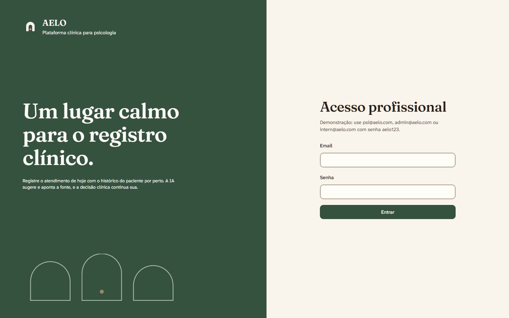

<p align="center">
  
</p>

# AELO-PSI

Plataforma para clínicas de psicologia: agenda, pacientes, prontuário assinado e uma **memória clínica** que mostra, com citação da nota de origem, como cada tema evolui ao longo das sessões. A IA roda localmente e só organiza o que já foi escrito. Quem interpreta e decide é o psicólogo.

TCC de Sistemas de Informação, UniCatólica de Quixadá, 2026. Protótipo de pesquisa: **somente dados sintéticos, não homologado para uso clínico.**

[](https://github.com/erik-hp/aelo-psi/actions/workflows/ci.yml)
[](LICENSE)

## O que faz

- **Agenda e pacientes**, com detecção de conflito de horário.
- **Prontuário versionado**: rascunho, revisão, assinatura digital (ECDSA) e retificação com motivo, sem perder a versão anterior.
- **Memória clínica**: grafo de conceitos por paciente, com trechos literais das notas e link para a nota de origem.
- **Segurança**: dados clínicos cifrados, acesso por vínculo explícito paciente-profissional e auditoria à prova de alteração.
- **IA que falha às claras**: se o modelo estiver fora do ar, o sistema avisa. Nunca inventa texto nem métrica.

| Editor de nota | Acesso profissional |
| --- | --- |
|  |  |

## Como funciona

```text
React  →  Django REST (regras, autorização, auditoria)  →  PostgreSQL + pgvector
                  │ fila no banco
           worker  →  FastAPI  →  Ollama (IA local)
```

O Django decide quem pode ler o quê. O serviço de IA não acessa o banco, e a inferência roda fora da requisição HTTP. Decisões de arquitetura: [`docs/architecture/`](docs/architecture/).

## Como rodar

Requisitos: Git, Node.js 22 e, para o caminho B, Docker e Python 3.12.

### A. Ver a interface (1 minuto, sem Docker)

Usa dados fictícios, sem back-end.

```bash
git clone https://github.com/erik-hp/aelo-psi.git
cd aelo-psi/Frontend
npm ci
VITE_USE_API=false npm run dev      # PowerShell: $env:VITE_USE_API="false"; npm run dev
```

Abra `http://localhost:5173` e entre com `psi@aelo.com` / `aelo123`.

### B. Sistema completo (back-end, banco e IA)

**1. Back-end**

```bash
cd Backend
python scripts/dev_setup.py env                       # gera o .env com segredos aleatórios
docker compose up --build -d
docker compose exec ollama ollama pull llama3.1       # modelo de texto (vários GB)
docker compose exec ollama ollama pull embeddinggemma # modelo de embeddings
python scripts/dev_setup.py user                      # cria o usuário "psi" e imprime a senha
```

A API fica em `http://127.0.0.1:8000/api/`.

**2. Front-end**, em outro terminal:

```bash
cd Frontend
cp .env.example .env                                  # PowerShell: Copy-Item .env.example .env
npm ci
npm run dev
```

Abra `http://localhost:5173` e entre com `psi` e a senha impressa no passo anterior. Para conferir: **Pacientes → Adicionar paciente → Agenda → agendar → Abrir editor → Salvar nota**.

**3. Memória clínica (opcional).** A leitura automática das notas vem desligada. Para ligá-la, acrescente ao `Backend/.env`:

```text
AELO_SYNTHETIC_DATA_ONLY=True
AI_AUTO_EXTRACTION=True
```

e rode `docker compose up -d`. Ao salvar uma nota, o worker extrai o grafo e a aba **Memória clínica** do paciente passa a mostrá-lo. Para encerrar: `docker compose down`.

## Testes

```bash
# Back-end (em Backend/, após: pip install -r requirements/dev.txt)
python -m pytest -q -p no:cacheprovider
python -m ruff check .

# Front-end (em Frontend/)
npm test && npm run lint && npm run build
```

Os testes que dependem de PostgreSQL (pgvector, triggers de auditoria) rodam em pilha isolada:

```bash
docker compose -p aelo-teste -f docker-compose.test.yml run --build --rm backend_test
docker compose -p aelo-teste -f docker-compose.test.yml down -v
```

## Documentação

- [Registro de execução e evidências](docs/REGISTRO_EXECUCAO.md) e [plano de implementação](docs/PLANO_MESTRE_IMPLEMENTACAO.md)
- [Operação do back-end](Backend/docs/OPERATIONS.md) e [exemplos da API](Backend/docs/API_EXAMPLES.md)
- [Mapa de dados e riscos de privacidade](docs/privacy/F0_DATA_MAP_RIPD_DRAFT.md)
- [Protocolo de avaliação com usuários (SUS e UMUX-Lite)](docs/validation/F6_PROTOCOLO_ENTREVISTAS_E_AVALIACAO_DSR.md)

## Limitações

- Somente dados sintéticos. Não há avaliação jurídica ou clínica que autorize prontuários reais.
- O mascaramento de identificadores é por regras e não equivale a anonimização.
- A qualidade da extração depende do modelo local e da memória da máquina.
- Os gráficos da aba Evolução no modo demonstração são fictícios. No modo real, a aba mostra só sinais linguísticos exploratórios.

Licença: [GNU AGPL v3](LICENSE).
