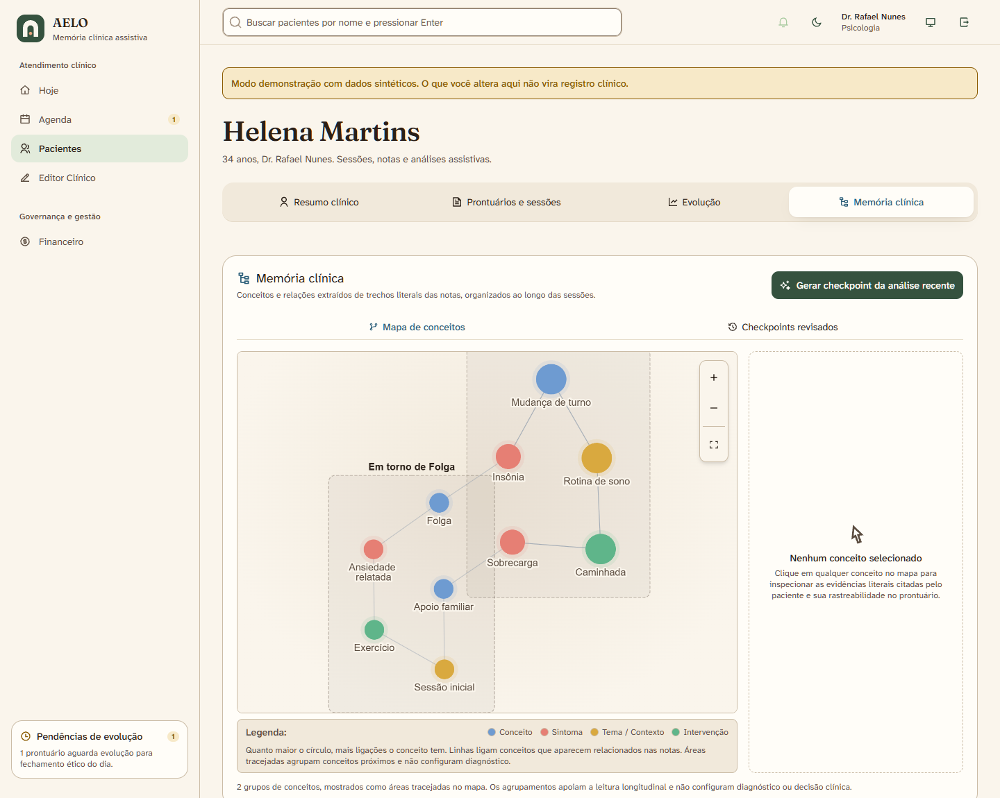
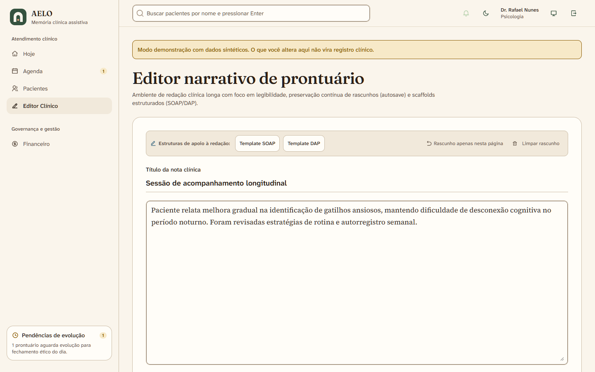

<p align="center">
  
</p>

# AELO-PSI

[](https://github.com/erik-hp/aelo-psi/actions/workflows/ci.yml)
[](LICENSE)


Plataforma web para clínicas de psicologia que combina agenda, cadastro de pacientes e prontuário com uma **memória clínica longitudinal assistida por IA local**. A IA organiza e localiza o que já foi escrito nas notas; quem interpreta, confirma ou rejeita é sempre o psicólogo.

Trabalho de conclusão de curso (Sistemas de Informação, UniCatólica de Quixadá, 2026), conduzido como pesquisa aplicada (Design Science Research).

> **Estado:** protótipo de pesquisa. Funciona somente com **dados sintéticos** e não está homologado para uso clínico real.

**Conteúdo:** [Problema](#1-problema-e-proposta) · [Funcionalidades](#2-funcionalidades) · [Telas](#telas) · [Arquitetura](#3-arquitetura) · [Como reproduzir](#4-como-reproduzir) · [Testes](#5-testes-e-verificação) · [Estrutura](#6-estrutura-do-repositório) · [Documentação](#7-documentação-complementar) · [Limitações](#8-limitações)

## 1. Problema e proposta

Meses depois de uma sessão, o profissional precisa saber quando um tema surgiu, o que foi registrado depois e que mudanças foram relatadas. Reler todo o histórico é lento e sujeito a esquecimentos.

O AELO-PSI lê as notas de cada paciente, extrai conceitos e relações **copiando rótulos e trechos literais** do texto, e monta um mapa da evolução ao longo do tempo (a "Memória clínica"). Toda informação exibida aponta para a nota de origem. A ferramenta não diagnostica, não pontua risco e não toma decisões clínicas.

Exemplo fictício: o profissional consulta o tema "sono". O sistema recupera as notas das sessões 1, 4 e 9, mostra como o assunto evoluiu e cita o trecho de cada uma. O profissional revisa e, se quiser, registra a revisão com assinatura digital.

## 2. Funcionalidades

- **Agenda e pacientes:** cadastro, agendamento com detecção de conflito de horário e atendimento por sessão.
- **Prontuário versionado:** notas com ciclo `rascunho → em revisão → assinada → retificada`. Assinatura e retificação (com motivo) usam ECDSA P-256 e preservam a versão anterior cifrada.
- **Memória clínica:** grafo de conceitos por paciente, com grupos nomeados, evidências literais e navegação até a nota de origem.
- **Recuperação em camadas:** seleção de contexto por grafo e por texto original, com vagas por rota e sem penalizar notas antigas ([ADR-003](docs/architecture/ADR-003-recuperacao-em-camadas.md)).
- **Evolução:** sinais linguísticos exploratórios ao longo das sessões ([F4](docs/validation/F4_INDICADORES_LONGITUDINAIS.md)).
- **Interoperabilidade:** exportação de recursos HL7 FHIR R4 com proveniência.
- **Avaliação:** calculadoras SUS e UMUX-Lite e protocolo de avaliação de usabilidade.

### Telas

Capturas do modo demonstração, com dados fictícios.

| Editor de nota | Acesso profissional |
| --- | --- |
|  |  |

## 3. Arquitetura

```text
React/Vite  →  Django REST (domínio, autorização, auditoria)  →  PostgreSQL + pgvector
                      │ fila no banco
               worker process_vault_jobs  →  FastAPI (ai_service)  →  Ollama (IA local)
```

| Camada | Tecnologia | Papel |
| --- | --- | --- |
| Interface | React, TypeScript, Vite, Tailwind CSS, React Query, BoardUI | Telas e navegação |
| API | Python, Django, Django REST Framework, JWT | Regras de negócio, autorização, auditoria |
| Worker | `manage.py process_vault_jobs` | Executa jobs de leitura de notas e checkpoints fora da requisição HTTP |
| Serviço de IA | FastAPI + Ollama | Inferência local, sem acesso ao banco |
| Banco | PostgreSQL 16 + pgvector | Dados relacionais e busca vetorial |

Decisões de projeto:

- **Autorização no back-end.** Acesso a conteúdo clínico exige um vínculo explícito entre profissional e paciente. Administradores veem o diretório, nunca o conteúdo clínico; estagiários apenas leem.
- **Dados clínicos cifrados na aplicação** (AES-256-GCM) e **auditoria** em cadeia HMAC, com triggers no PostgreSQL que impedem alterar eventos.
- **IA local por padrão.** O Ollama é o único destino de conteúdo clínico ([ADR-004](docs/architecture/ADR-004-ia-externa.md)). Provedores externos existem apenas para experimentos com dados sintéticos e são recusados quando o HTTPS está ativo.
- **Falha explícita da IA.** Se o modelo estiver indisponível, o sistema informa o erro; nunca inventa texto ou métricas.
- **Mascaramento antes do envio.** O texto passa por regras de desidentificação e o envio é bloqueado se restar identificador direto. Não é anonimização completa.
- **Inferência assíncrona.** As rotas de análise enfileiram o trabalho e respondem HTTP 202.

Diagrama completo: [`docs/img/arquitetura.png`](docs/img/arquitetura.png). Decisões arquiteturais: [`docs/architecture/`](docs/architecture/).

## 4. Como reproduzir

### 4.1 Pré-requisitos

- Git
- Docker com Compose
- Node.js 22 e npm (versão usada na CI)
- Cerca de 10 GB livres em disco para as imagens e os modelos do Ollama
- Para os testes fora do Docker: Python 3.12+

Use apenas dados sintéticos.

### 4.2 Obter o código

```bash
git clone https://github.com/erik-hp/aelo-psi.git
cd aelo-psi
```

### 4.3 Back-end, banco e IA

```bash
cd Backend
python scripts/dev_setup.py env      # cria Backend/.env com segredos aleatórios
```

O script copia `.env.example` e gera `DJANGO_SECRET_KEY`, `CLINICAL_DATA_KEYS`, `AUDIT_LOG_HMAC_KEY`, `POSTGRES_PASSWORD` e `AI_SERVICE_TOKEN`. Se preferir, copie o arquivo manualmente e troque cada valor `replace-with-...`. `CLINICAL_DATA_KEYS` deve ser base64 de 32 bytes. Não publique o `.env`.

Suba os serviços e baixe os modelos de IA (a primeira vez demora):

```bash
docker compose up --build -d
docker compose exec ollama ollama pull llama3.1
docker compose exec ollama ollama pull embeddinggemma
docker compose ps
```

O Compose inicia `db`, `migrate`, `api`, `ai-service`, `vault-worker` e `ollama`. Apenas a API é publicada em `http://127.0.0.1:8000/api/`; IA e Ollama ficam na rede interna do Docker. O modelo é configurável por `OLLAMA_MODEL` e `OLLAMA_NUM_CTX`; prompts maiores que o contexto falham de forma explícita.

### 4.4 Criar clínica e usuário de teste

Nenhuma conta é criada automaticamente. Com os containers no ar:

```bash
python scripts/dev_setup.py user     # cria a clínica sintética e o usuário "psi"; imprime a senha gerada
```

Opcionalmente, para popular um paciente e uma sessão fictícios (o comando exige um superusuário vinculado a uma clínica):

```bash
docker compose exec api python manage.py createsuperuser
docker compose exec -e AELO_ALLOW_SYNTHETIC_SEED=1 api python manage.py seed_initial_data --admin-username <usuario>
```

### 4.5 Front-end

Em outro terminal:

```bash
cd Frontend
cp .env.example .env          # VITE_USE_API=true aponta para a API local
npm ci
npm run dev
```

Abra `http://localhost:5173` e entre com o usuário criado. Fluxo para conferir: **Pacientes → Adicionar paciente → Agenda → agendar sessão → Abrir editor → Salvar nota**. Salvar a nota não depende da IA nem a assina.

Para ver a interface sem back-end, defina `VITE_USE_API=false` no `.env`. Nesse modo a interface usa dados demonstrativos fictícios (login `psi@aelo.com`, senha `aelo123`).

### 4.6 Leitura automática de notas e memória clínica

A extração do grafo é desligada por padrão. Para ativá-la em ambiente de teste, defina no `Backend/.env`:

```text
AELO_SYNTHETIC_DATA_ONLY=True
AI_AUTO_EXTRACTION=True
AI_LOD_RETRIEVAL=True        # recuperação em camadas (opcional)
```

e reinicie com `docker compose up -d`. Ao salvar uma nota, o `vault-worker` processa o job e a aba **Memória** do paciente passa a mostrar o grafo. Essas opções são recusadas pela configuração quando o HTTPS está ativo.

Para encerrar: `docker compose down` (acrescente `-v` apenas se quiser apagar o banco e os modelos).

## 5. Testes e verificação

**Back-end** (a partir de `Backend/`, com um ambiente virtual Python e `pip install -r requirements/dev.txt`):

```bash
python -m pytest -q -p no:cacheprovider                    # SQLite; testes de pgvector são ignorados
python -m ruff check .
python manage.py makemigrations --check --dry-run --settings=config.settings_test
```

Os testes que dependem de PostgreSQL (`select_for_update`, pgvector, triggers de auditoria) rodam em pilha isolada, sem tocar nos containers de desenvolvimento:

```bash
docker compose -p aelo-teste -f docker-compose.test.yml run --build --rm backend_test
docker compose -p aelo-teste -f docker-compose.test.yml down -v

docker compose -p aelo-smoke -f docker-compose.security.yml run --build --rm security_smoke   # HTTP real, Caddy e CSP
docker compose -p aelo-smoke -f docker-compose.security.yml down -v
```

**Front-end** (a partir de `Frontend/`):

```bash
npm run lint
npm test
npm run build
```

**Avaliações sintéticas** (não fazem parte da suíte e precisam ser chamadas explicitamente, a partir de `Backend/`):

```bash
python -m pytest -q -s -p no:cacheprovider tests/evaluate_lod_retrieval.py
python -m pytest -q -s -p no:cacheprovider tests/evaluate_deidentification.py
python tests/evaluate_extraction.py        # exige Ollama em execução
```

## 6. Estrutura do repositório

```text
Backend/
  apps/         users, clinics, patients, therapy_sessions, clinical_notes, ai_analysis, audit_logs
  ai_service/   FastAPI e integração com Ollama
  services/     segurança (cifra, anonimização), cliente de IA, métricas
  config/       configurações Django
  tests/        testes e avaliações sintéticas
Frontend/src/   pages, components, services, api, routes
docs/           arquitetura (ADRs), validação, segurança, privacidade, design
tools/          executor local de verificações (local_ci.py)
```

## 7. Documentação complementar

- [Decisões arquiteturais (ADRs)](docs/architecture/)
- [Plano de implementação e matriz de requisitos](docs/PLANO_MESTRE_IMPLEMENTACAO.md), [requisitos](docs/MATRIZ_REQUISITOS.md)
- [Registro de execução e evidências](docs/REGISTRO_EXECUCAO.md)
- [Operação do back-end](Backend/docs/OPERATIONS.md) e [exemplos da API](Backend/docs/API_EXAMPLES.md)
- [Vault e GraphRAG](Backend/docs/VAULT_GRAPHRAG.md)
- [Mapa de dados e riscos de privacidade](docs/privacy/F0_DATA_MAP_RIPD_DRAFT.md)
- [Protocolo de avaliação com usuários (SUS e UMUX-Lite)](docs/validation/F6_PROTOCOLO_ENTREVISTAS_E_AVALIACAO_DSR.md)
- [Identidade visual e sistema de design](docs/design/AELO_DESIGN_SYSTEM.md)

## 8. Limitações

- Somente dados sintéticos. Não há avaliação jurídica ou clínica que autorize prontuários reais.
- O mascaramento de identificadores é baseado em regras e não equivale a anonimização.
- Os sinais linguísticos da aba Evolução são exploratórios, não são escores clínicos validados.
- A qualidade da extração depende do modelo local escolhido e da memória disponível na máquina.

## Licença

[GNU AGPL v3](LICENSE).
