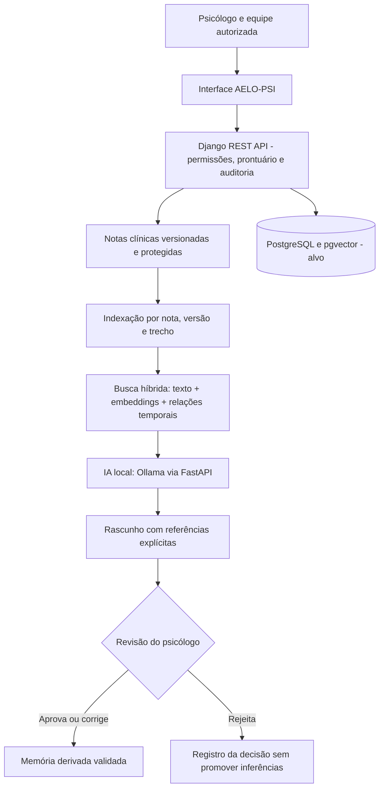

# AELO-PSI — Gestão Clínica e Memória Terapêutica Inteligente

> **Projeto acadêmico de TCC2 | Sistemas de Informação — Centro Universitário Católica de Quixadá (UniCatólica), 2026**  
> **Estado:** protótipo em desenvolvimento; **não homologado para operação clínica real**.  
> **Documento orientador da engenharia:** [Plano Mestre de Implementação](docs/PLANO_MESTRE_IMPLEMENTACAO.md). **Não confunda funcionalidades planejadas com implementadas.**

## 1. O que é o AELO-PSI?

O AELO-PSI é um projeto de plataforma web para apoiar psicólogos em tarefas operacionais e na organização de registros de acompanhamento terapêutico. O objetivo não é fazer terapia, diagnosticar ou substituir o psicólogo. A proposta combina uma agenda, cadastro de pacientes e prontuários com ferramentas **assistivas** para localizar informações documentadas, elaborar rascunhos de sínteses e observar temas que reaparecem ao longo do histórico clínico.

**Para quem não é da área técnica:** imagine que, meses depois de uma consulta, o profissional queira recuperar quando um assunto começou a aparecer, o que foi registrado em sessões posteriores e quais mudanças foram relatadas. A ideia é tornar essa revisão mais ágil, mostrando sempre **de qual nota veio cada informação** e deixando a interpretação para o psicólogo.

O software é uma pesquisa aplicada com **Design Science Research (DSR)**. A avaliação planejada inclui testes de tarefas, recuperação e fidelidade das fontes, além das escalas de usabilidade **SUS** e **UMUX-Lite**, conforme o projeto de TCC fornecido pelo autor. As avaliações não devem ser tratadas como realizadas até haver coleta e análise documentadas.

## 2. O diferencial: notas interligadas e memória clínica temporal

O módulo planejado **Memória Terapêutica Longitudinal Inteligente (MTLI)** é inspirado na ideia de notas conectadas e no GraphRAG, mas é **desenvolvido dentro do próprio AELO-PSI** — **não é necessário instalar ou utilizar o Obsidian**.

Exemplo **fictício**, sem identificar pessoas:

1. Na sessão 1, o registro menciona dificuldades de sono e sobrecarga profissional.
2. Na sessão 4, o texto relata persistência das dificuldades e novos aspectos de contexto familiar.
3. Na sessão 9, registra-se melhora relatada do sono após ajustes de rotina.
4. O sistema deverá permitir consultar o tema “sono”, recuperar as três anotações, apresentar possíveis conexões e **citar as notas e trechos correspondentes**.
5. O psicólogo confirma, corrige ou rejeita relações e interpretações sugeridas.

Essa memória **não é treinamento autônomo do modelo**: o aprimoramento é incremental (mais notas indexadas, relações documentadas e correções humanas) sem transformar hipóteses em fatos. Prontuários originais não são substituídos por resumos, e a recuperação de um paciente nunca pode buscar registros de outro.

### Fluxo de alto nível — arquitetura alvo, ainda não totalmente implementada



*As setas representam o desenho pretendido, não uma alegação de que todo o pipeline já funciona.*

## 3. O que existe hoje e o que está planejado?

**Snapshot de 09/11/2026 — branch do [PR #24](https://github.com/erik-hp/aelo-psi/pull/24), ainda sem merge:** [baseline e evidências](docs/validation/F0_2026-11-09.md), [matriz de autorização](docs/validation/F0_AUTHORIZATION_MATRIX_2026-11-09.md). Campos clínicos cifrados, grants explícitos, refresh HttpOnly, auditoria com integridade e componentes experimentais de memória já existem; seus aceites completos continuam pendentes. Nesta entrega, risco automático e escores de atenção foram removidos da demonstração. Frontend: 220 testes, build e lint aprovados; backend: 291 aprovados/2 ignorados, incluindo 79 novos cenários de autorização. O inventário inicial abaixo é histórico e não substitui o registro atualizado. G0 segue bloqueado.

**Continuação F0-02:** seletores HTML e filtros relacionais agora respeitam o escopo antes da validação, corrigindo vazamento de nomes e enumeração de IDs. Mais 164 cenários de listagens, mutações, concessões, revisão assinada e exportação passaram; backend SQLite **455 aprovados/2 ignorados** e PostgreSQL/pgvector local **457 aprovados**. A CI de `b3ca6ef` ficou incompleta por falhas de inicialização, embora smoke/carga remotos tenham passado. [Relatório atual](docs/validation/F0_AUTHORIZATION_BOUNDARIES_2026-11-09.md). O snapshot anterior permanece como histórico; a revisão integral e G0 continuam pendentes.

O [plano operacional digital da clínica](docs/PLANO_OPERACIONAL_CLINICA.md), pesquisado em 06/11/2026, descreve jornada, necessidades, base normativa, permissões, lacunas e sequência proposta para estabilizar a operação antes da IA. É planejamento em revisão; funcionalidades novas e integrações não estão implementadas por constarem nele.

**Atualização operacional de 06/11/2026 (em revisão):** em modo API, o profissional autorizado pode seguir **Pacientes → Adicionar paciente → Agenda → agendar → Abrir editor → Salvar nota**. Cadastro, agendamento e nota foram verificados com dados sintéticos na API local; salvar não depende da IA e concluir atendimento não assina a nota. Achados, correções, testes e funcionalidades ainda pendentes estão na [auditoria funcional](docs/validation/AUDITORIA_FUNCIONAL_2026-11-06.md). Essa evidência incremental não libera uso clínico ou os gates do Plano Mestre.

O inventário abaixo resulta de **leitura estática do repositório**; não houve neste registro comprovação de compilação, testes em runtime ou validação clínica. A matriz de requisitos descreve exatamente o que falta.

| Funcionalidade | Situação verificável |
| --- | --- |
| Front-end React + TypeScript e páginas de pacientes, agenda, dashboard, análises, auditoria e configurações | **Estrutura existente** |
| Back-end Django REST Framework com usuários, clínicas, pacientes, sessões e notas clínicas | **Estrutura existente** |
| Autenticação JWT e permissões básicas | **Existentes, precisam endurecimento e testes** |
| Serviço FastAPI + comunicação com Ollama local | **Integração inicial existente** |
| Notas e histórico de versão | **Modelo inicial existente; assinatura/imutabilidade ainda incompletas** |
| Desidentificação | **Regras regex iniciais; não equivalem a anonimização** |
| IA clínica com citações validadas e RAG vetorial | **Planejado / ainda não demonstrado** |
| PostgreSQL + pgvector, grafo temporal e MTLI | **Planejados** |
| Painel longitudinal e indicadores linguísticos confiáveis | **Interface inicial; algumas métricas atuais usam dados simulados, não escores clínicos validados** |
| Criptografia clínica, segregação verificável, auditoria forte, gestão de chaves | **Pendentes de implementação/validação integral** |
| FHIR, resultados SUS/UMUX-Lite e estudo DSR final | **Planejados; sem resultados demonstrados** |

**Aviso técnico importante:** há mecanismos demonstrativos e respostas de contingência no código atual que não devem ser usados para inferência clínica nem interpretados como resultados reais. O primeiro ciclo de trabalho é corrigir esses riscos.

## 4. Princípios inegociáveis

- **Psicólogo no controle:** a IA apenas auxilia; não conclui diagnósticos nem toma decisões clínicas autônomas.
- **Sigilo e autorização:** cada ação deve restringir o acesso à clínica, ao paciente, à função profissional e às permissões apropriadas.
- **Histórico íntegro:** notas assinadas não podem sofrer edição silenciosa; retificações devem manter rastreabilidade.
- **Fontes visíveis:** sínteses e relações clínicas precisam de nota, versão e trecho que fundamentem cada afirmação.
- **Falhas transparentes:** indisponibilidade de IA não pode produzir métricas ou textos falsos como substituição.
- **Memória revisada, não “autoavaliação” do paciente:** relações são propostas/derivadas, diferenciadas dos registros e validadas por profissional.
- **Dados mínimos, processamento local, proteção por padrão:** executar localmente **reduz** exposição a provedores, mas não prova conformidade à LGPD.
- **Desenvolvimento e demonstração apenas com dados sintéticos** até haver governança e aprovações adequadas.

A arquitetura considera LGPD (Lei nº 13.709/2018), orientações da ANPD, regras profissionais pertinentes, [OWASP ASVS](https://github.com/OWASP/ASVS), [WCAG 2.2](https://www.w3.org/TR/WCAG22/) e [HL7 FHIR](https://hl7.org/fhir/R4/). Não há alegação de certificação nem conformidade automaticamente garantida.

> **Precisão acadêmica:** a Resolução CFP 09/2024 aborda exercício profissional mediado por TDICs, **não** é uma norma específica proibindo diagnósticos de IA. O posicionamento do CFP sobre IA publicado em 2025 deve ser considerado separadamente. A situação de vigência das normas sobre registro documental precisa de verificação antes de alegações finais. RAG não elimina alucinações e NER não garante anonimização irreversível.

## 5. Tecnologias — base atual e evolução

| Camada | Tecnologia | Papel |
| --- | --- | --- |
| Interface atual | React, Vite, TypeScript, Tailwind CSS, Recharts, React Query | Telas, navegação e gráficos |
| API principal atual | Python, Django, Django REST Framework | Regras de negócio, usuários, registros, permissões |
| Serviço de IA atual | Python, FastAPI, Ollama | Inferência assistiva local |
| Banco atual | PostgreSQL | Persistência relacional |
| Banco alvo | PostgreSQL **com pgvector** | Recuperação semântica e relações temporais |
| Implantação de desenvolvimento | Docker Compose | Execução de serviços locais |
| Evolução planejada | Embeddings multilíngues, NER, recuperação híbrida, testes automatizados e auditoria | Memória segura e validação científica |

**Decisão:** não reescrever tudo em FastAPI nem adicionar Neo4j apenas porque existe um grafo. Django continua responsável pelo domínio; FastAPI pelo processamento de IA; relações podem ser armazenadas no PostgreSQL. Mudança de stack exige decisão arquitetural documentada.

## 6. Como executar o protótipo de desenvolvimento

**Pré-requisitos:** Git, Docker com plugin Compose e Node.js/npm compatíveis com o projeto; espaço para baixar o modelo do Ollama e recursos computacionais suficientes. Não há garantia de tempo de execução nem de aceleração GPU nesta versão.

> Estes comandos explicam a estrutura **existente**. A versão anterior inicializava uma conta de demonstração com senha fixa. A partir da F0-04, o Compose não executa mais esse seed automaticamente; contas são criadas de modo explícito no ambiente isolado. Use somente máquina/ambiente isolado de desenvolvimento, nunca rede pública ou prontuário real.

### 6.1. Obter o código

```bash
git clone https://github.com/erik-hp/aelo-psi.git
cd aelo-psi
```

O repositório é privado: é preciso ter permissão no GitHub. Este README pertence à `main` após a integração do PR de documentação. O histórico da proposta e sua revisão permanecem disponíveis no [Pull Request #1](https://github.com/erik-hp/aelo-psi/pull/1). Para reproduzir exatamente uma versão, utilize o commit/release registrado na avaliação do TCC.

### 6.2. Back-end, banco e IA

```bash
cd Backend
cp .env.example .env
docker compose up --build -d
docker compose ps
```

No **Windows PowerShell**, substitua `cp` por `Copy-Item .env.example .env`, se necessário. **Edite o `.env` antes de uso**, definindo segredos locais não triviais; não publique o arquivo. O Compose sobe `db`, `api`, `ai-service` e `ollama`; apenas banco e API são publicados em portas de loopback, enquanto IA e Ollama ficam em rede interna. Defina as credenciais antes de iniciar.

Endereços de desenvolvimento configurados no projeto:
- Django API: `http://localhost:8000/api/`
- FastAPI: `http://ai-service:8001/health` (somente rede Docker)
- Ollama: `http://ollama:11434` (somente rede Docker, sem exposição pública)

Verificar registros/erros:

```bash
docker compose logs --tail=100 api ai-service ollama
docker compose exec api python manage.py check
```

Os pesos do modelo **não são automaticamente instalados** pelo Compose atual. O modelo configurado em `Backend/.env.example` é `llama3.1`, e a instalação local pode exigir:

```bash
docker compose exec ollama ollama pull llama3.1
```

O endpoint `/health` apenas confirma o processo FastAPI; não garante que o modelo esteja disponível, que RAG funcione ou que as respostas sejam adequadas. **As portas/seed atuais são de desenvolvimento e devem ser protegidas** (fase F0).

Para desligar:

```bash
docker compose down
```

Não use `docker compose down -v` sem intenção explícita de excluir volumes persistidos.

### 6.3. Front-end

Abra outro terminal a partir da raiz:

```bash
cd Frontend
cp .env.example .env
npm ci
npm run dev
```

No Windows PowerShell, `Copy-Item .env.example .env` também funciona. Abra o endereço indicado pelo Vite, normalmente `http://localhost:5173`. A configuração `VITE_USE_API=true` aponta para a API; com `false`, partes da interface utilizam dados demonstrativos **não clínicos**.

Outros comandos disponíveis:

```bash
npm run lint
npm run build
```

Para executar os checks de qualidade sem depender da cota GitHub Actions, use `python tools/local_ci.py` na raiz, com Docker Linux e Python 3.12+. O executor valida o commit, usa somente dados sintéticos e grava evidências em `reports/local-ci/`. Veja [pré-requisitos, cobertura e limites](docs/validation/LOCAL_CI.md). Alterações não commitadas ficam fora da execução.

**Não foi executada uma verificação de build neste documento.** Se algum comando falhar, registrar o problema em F0-01 antes de alterar dependências em lote.

### 6.4. Segurança de demonstração

O comando de seed foi alterado para **não criar contas nem senhas** e somente aceitar dados sintéticos mediante opt-in explícito. O Compose não o executa automaticamente. Após iniciar, crie o administrador de desenvolvimento com `docker compose exec api python manage.py createsuperuser`; associe o usuário a uma clínica antes de cadastrar pacientes. Use somente dados sintéticos em um ambiente isolado. Nenhum dado de paciente real deve entrar no ambiente de demonstração atual.

## 7. Organização do repositório

```text
aelo-psi/
├── AGENTS.md                 # Regras persistentes para colaboração e IA de código
├── README.md                 # Visão geral, instalação e status do projeto
├── Backend/
│   ├── apps/                 # users, clinics, patients, therapy_sessions,
│   │                         # clinical_notes, ai_analysis, audit_logs, ...
│   ├── ai_service/           # FastAPI e comunicação com Ollama
│   ├── services/             # Serviços auxiliares de segurança, IA, métricas
│   ├── config/               # Configurações e rotas Django
│   ├── docs/                 # Documentação operacional/API atual
│   ├── docker-compose.yml
│   └── requirements/
├── Frontend/
│   └── src/
│       ├── app/             # Inicialização
│       ├── components/      # Componentes visuais
│       ├── pages/           # Telas atuais
│       ├── routes/          # Rotas e proteção de telas
│       └── services/        # Integrações API e mocks demonstrativos
└── docs/
    ├── PLANO_MESTRE_IMPLEMENTACAO.md
    ├── MATRIZ_REQUISITOS.md
    ├── REGISTRO_EXECUCAO.md
    └── architecture/
        └── ADR-001-memoria-terapeutica-longitudinal.md
```

Estrutura futura, depois dos gates de segurança: `Backend/apps/patient_memory/`, serviços de indexação/busca, `Frontend/src/features/patient-knowledge/` e documentação de privacidade/testes/interoperabilidade. Estas pastas **ainda não devem ser consideradas implementadas**.

## 8. Plano de desenvolvimento: 8 fases com critérios obrigatórios

A execução detalhada está no [Plano Mestre](docs/PLANO_MESTRE_IMPLEMENTACAO.md). As fases são sequenciais por dependência e só avançam quando os critérios de passagem são efetivamente verificados.

| Fase | Entrega | Regra de passagem |
| --- | --- | --- |
| **F0 — Fundação segura** | Baseline, acesso por paciente/clínica, fim do fallback de IA fictício, CI e inventário de dados | Testes de acesso, falha explícita e ambiente reproduzível |
| **F1 — Prontuário confiável** | Gestão operacional, nota assinada/versionada, criptografia, auditoria | Documento íntegro, autorizado e auditável |
| **F2 — RAG rastreável** | pgvector, embeddings, busca híbrida e sínteses citadas | Fontes verificáveis e sem vazamento entre pacientes |
| **F3 — Memória terapêutica** | Temas/eventos/relações, revisão humana e grafo temporal | Relações vinculadas e revisão demonstrada |
| **F4 — Indicadores** | Métricas textuais longitudinais, limites e gráficos | Definições, versões, incertezas e validação técnica |
| **F5 — Interoperabilidade** | Mapeamentos/exports FHIR e governança | Exportação testada e controles documentados |
| **F6 — Validação DSR** | RAG vs memória temporal; SUS, UMUX-Lite, usabilidade | Resultados reais e metodologia reproduzível |
| **F7 — Entrega do TCC** | Documentação, testes finais, release e demonstração | Código, evidências e texto acadêmico coerentes |

**Situação em 17/10/2026:** as primeiras correções de segurança F0 foram integradas pelo PR #2. A fase F0 continua em andamento e **nenhum gate para uso clínico real foi liberado**. O estado verificável e a próxima tarefa estão em [Registro de Execução](docs/REGISTRO_EXECUCAO.md).

## 9. Como contribuir sem perder o escopo do TCC

Para iniciar qualquer alteração:

1. Ler [AGENTS.md](AGENTS.md), [Plano Mestre](docs/PLANO_MESTRE_IMPLEMENTACAO.md), [Matriz de Requisitos](docs/MATRIZ_REQUISITOS.md), [Registro de Execução](docs/REGISTRO_EXECUCAO.md) e [ADR-001](docs/architecture/ADR-001-memoria-terapeutica-longitudinal.md).
2. Escolher a menor tarefa da fase desbloqueada e citar o ID (ex.: `F0-02`) no issue/PR.
3. Especificar comportamento, permissões, caso de erro, impacto em dados pessoais e testes.
4. Implementar em branch própria quando a mudança for grande ou arriscada; usar migrações, testes e documentação proporcional à mudança.
5. Revisar diffs, executar checks realmente disponíveis, registrar resultados completos e limitações.
6. Atualizar matriz/registro e solicitar revisão no PR. Não marcar **CONCLUÍDO** sem evidência verificável.

**Convenções:** código organizado por domínio, validação de entrada, nomenclatura clara, TypeScript estrito, modelos e contratos consistentes, testes automatizados, dados sintéticos, mensagens acessíveis. Mudança arquitetural relevante requer uma nova **ADR (Architecture Decision Record)**.

### Definição de concluído, em linguagem simples

Uma função **não está pronta** apenas porque a tela abriu ou porque o modelo respondeu. Ela precisa funcionar nos cenários previstos, bloquear usos indevidos, lidar com erros, preservar informações e ter testes e documentação suficientes para outra pessoa verificar.

## 10. Pesquisa acadêmica, ética e métricas

O TCC adota **DSR**. As hipóteses visam investigar redução do esforço de documentação, aceitabilidade tecnológica e utilidade percebida de indicadores narrativos longitudinais. Para comparar soluções, o projeto prevê:
- Recuperação manual no histórico;
- RAG tradicional com busca textual/vetorial;
- Memória Terapêutica Longitudinal com relações/tempo/revisão.

Indicadores de engenharia planejados: `Recall@k`, precisão das citações, taxa de afirmações sem evidência, cobertura de sessões antigas, latência, erros de autorização e integridade. Indicadores de interação: taxa de sucesso da tarefa, tempo, erros observados, SUS e UMUX-Lite. Não apresentar resultados hipotéticos como medidos.

A pesquisa com pessoas exige verificar e cumprir a situação ética aplicável, incluindo CEP quando necessário, TCLE e tratamento adequado de gravações e respostas. Usar dados **sintéticos** nos protótipos de validação de prontuário, protegendo os próprios dados dos participantes da pesquisa.

O [inventário técnico inicial de dados e riscos (RIPD: rascunho)](docs/privacy/F0_DATA_MAP_RIPD_DRAFT.md) registra fluxos de tratamento, medidas existentes e pendências de avaliação jurídica/profissional. A documentação de avaliação e outros planos de segurança serão acrescentados nas fases correspondentes. O relatório do TCC deve ser atualizado à medida que existirem evidências e resultados concretos.

## 11. Perguntas frequentes

**A plataforma substitui o psicólogo?** Não. A IA fornece apoio documental, busca, rascunhos e hipóteses revisáveis; o profissional mantém julgamento e responsabilidade.

**A ferramenta aprende tudo sobre cada paciente?** Não no sentido de treinar sozinha uma IA. O sistema propõe uma **memória documental acumulativa**, com fontes, correções humanas, revisões e controle de acesso.

**Preciso instalar Obsidian?** Não. A ideia de conexões entre notas será implementada no AELO-PSI.

**Os registros antigos são descartados?** Não. O histórico é preservado; índices e snapshots são complementos reconstruíveis.

**A IA vai apontar depressão, risco de suicídio ou conduta terapêutica?** Não faz parte do escopo do sistema. Indicadores linguísticos não são diagnósticos nem decisões de tratamento.

**Está adequado à LGPD e às regras profissionais?** Ainda não é possível afirmar. Há requisitos, controles, testes e revisões planejados; aderência deve ser evidenciada e avaliada por responsáveis qualificados.

**Já posso usar com pacientes reais?** **Não.** O estado atual é de desenvolvimento, com riscos conhecidos e funcionalidades simuladas.

**Como retomar o trabalho no futuro?** Comece em [Registro de Execução](docs/REGISTRO_EXECUCAO.md) e siga o ID da próxima tarefa; o histórico de conversa não substitui os arquivos versionados.

## 12. Fontes e documentação complementar

**Documentos do projeto**
- [Plano Mestre: fases, dependências e gates](docs/PLANO_MESTRE_IMPLEMENTACAO.md)
- [Matriz de rastreabilidade](docs/MATRIZ_REQUISITOS.md)
- [Registro de execução e decisões](docs/REGISTRO_EXECUCAO.md)
- [F0-06: mapa de dados e riscos (rascunho)](docs/privacy/F0_DATA_MAP_RIPD_DRAFT.md)
- [ADR-001: Memória Terapêutica Longitudinal Inteligente](docs/architecture/ADR-001-memoria-terapeutica-longitudinal.md)
- [Instruções de contribuição e para assistentes](AGENTS.md)
- [Operações atuais do back-end](Backend/docs/OPERATIONS.md)
- [Exemplos da API atual](Backend/docs/API_EXAMPLES.md)

**Referências públicas**
- [Lei Geral de Proteção de Dados (LGPD)](https://www.planalto.gov.br/ccivil_03/_ato2015-2018/2018/lei/l13709.htm)
- [ANPD: Relatório de Impacto à Proteção de Dados Pessoais](https://www.gov.br/anpd/pt-br/canais_atendimento/agente-de-tratamento/relatorio-de-impacto-a-protecao-de-dados-pessoais-ripd)
- [CFP: posicionamento sobre IA na prática psicológica (2025)](https://site.cfp.org.br/cfp-divulga-posicionamento-sobre-inteligencia-artificial-no-contexto-da-pratica-psicologica/)
- [W3C — WCAG 2.2](https://www.w3.org/TR/WCAG22/)
- [OWASP — ASVS](https://github.com/OWASP/ASVS)
- [HL7 — FHIR R4](https://hl7.org/fhir/R4/)
- [pgvector](https://github.com/pgvector/pgvector)
- [Microsoft GraphRAG (referência arquitetural, não dependência)](https://microsoft.github.io/graphrag/)

---

**Pesquisa e desenvolvimento:** trabalho de conclusão de curso em Sistemas de Informação, UniCatólica de Quixadá, 2026. O título acadêmico, hipóteses, método DSR e instrumentos de avaliação têm como base o texto de TCC fornecido pelo pesquisador; decisões arquiteturais adicionais são propostas de implementação e devem ser verificadas nos resultados e revisadas no processo de orientação.

**Licença:** consulte o arquivo [LICENSE](LICENSE) do repositório. A disponibilidade do código ou desta documentação não concede autorização para uso clínico sem os controles e requisitos apropriados.
