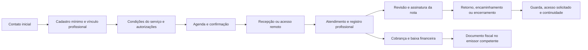

# Plano operacional digital da clínica — AELO-PSI

**Versão 0.1 — pesquisa de 06/11/2026 — PROPOSTA EM REVISÃO.**

Este documento responde à solicitação de priorizar a operação da clínica antes de retomar a análise de notas por IA. É um levantamento de necessidades e plano de implementação, sem alterações de funcionalidades. Complementa o [Plano Mestre](PLANO_MESTRE_IMPLEMENTACAO.md), a [matriz](MATRIZ_REQUISITOS.md), o [registro](REGISTRO_EXECUCAO.md) e a [auditoria funcional](validation/AUDITORIA_FUNCIONAL_2026-11-06.md). Não substitui suas fases ou libera gates; **G0 permanece bloqueado**.

## 1. Premissas, alcance e decisões

Referência inicial, ainda a confirmar com o autor: clínica particular brasileira com equipe, atendimento presencial/online e possibilidade de atender menores. Consultório individual usa um subconjunto; clínica-escola requer supervisão adicional. Município, regime PF/PJ, convênios, serviços e estrutura física ainda não foram definidos. Não é possível declarar uma lista universal de licenças locais sem essas informações.

Classificação usada: **N** = obrigação/condicionante com fonte normativa ou orientação oficial, cuja aplicação deve ser validada; **O** = necessidade operacional proposta; **E** = extensão conforme modelo de negócio. Prioridades **P0/P1/P2** significam, respectivamente, proteção e continuidade, núcleo operacional e ampliação. Não são fases novas do Plano Mestre.

As recomendações de telas, contratos de API, entidades e backlog abaixo são **propostas de engenharia derivadas da pesquisa e do código**, não comandos impostos pelas fontes. Fontes oficiais foram consultadas em 06/11/2026; páginas informativas antigas não comprovam, isoladamente, a consolidação completa de todas as normas e alterações. Revisar novamente antes da implantação.

**Decisão de trabalho desta rodada:** documentar o núcleo sem IA e as ampliações em backlog. Nenhuma integração, papel, tabela ou automação nova foi implementada. Retomar IA depois de validar as tarefas operacionais e os gates aplicáveis; não renumerar F0–F7.

**Adendo de estabilização solicitado em 06/11/2026:** a estrutura de navegação e a clareza de várias telas ainda são consideradas insatisfatórias pelo autor. A padronização de componentes não encerra esse problema. Será realizada uma [análise de UX/navegação e pesquisa comparativa de frontends](validation/PLANO_REVISAO_UX_NAVEGACAO.md), vinculada a OP-01/OP-06/OP-10, com inventário, evidências, protótipos e validação antes/depois. A [avaliação do Strix](security/PLANO_AVALIACAO_STRIX.md) fica planejada para o marco verificável de aproximadamente 80% do escopo funcional aprovado pronto/auditável, com controles críticos completos e ambiente sintético isolado. O marco não adia a segurança F0 nem libera uma versão estável automaticamente.

## 2. Base normativa e suas consequências

| Tema | Constatação verificada e consequência para o planejamento |
| --- | --- |
| Regularidade profissional/institucional — N | A orientação do CFP diferencia registro de PJ com atividade principal e cadastro com atividade secundária em Psicologia; contempla responsabilidade técnica e documentação institucional. Manter comprovações e responsáveis, com conferência pelo CRP competente. [CFP, Resolução 16/2019](https://site.cfp.org.br/cfp-publica-nova-resolucao-sobre-pessoa-juridica/). |
| Estabelecimento — N | O Ministério da Saúde descreve o CNES como cadastro obrigatório de estabelecimentos de saúde públicos/privados. Confirmar enquadramento e procedimento com gestor local, além de licenças municipais/sanitárias aplicáveis. Não confundir cadastro CNES com integração automática do software ao SUS. [Ministério da Saúde](https://webatendimento.saude.gov.br/faq/rnds). |
| Registro psicológico — N | A Resolução 001/2009 prevê registro atualizado, identificação, demanda/objetivos, evolução e encaminhamento/encerramento; serviço-escola identifica supervisor e estagiário. Projetar organização e autoria, além de campo livre. Consultar a versão atualizada pela 005/2010. [Texto do CFP](https://site.cfp.org.br/wp-content/uploads/2009/04/resolucao2009_01.pdf), [orientação CRP-12](https://transparencia.cfp.org.br/crp12/pergunta-frequente/registro-documental/). |
| Documentos externos — N | A Resolução 06/2019 trata de documentos psicológicos, destinatários e envio. Documento emitido não se confunde com nota interna ou comprovante fiscal; modelos exigem elaboração e revisão profissional. [CFP, apresentação da resolução](https://site.cfp.org.br/cfp-publica-versao-comentada-da-resolucao-sobre-a-elaboracao-de-documentos-escritos/). |
| Guarda — N | A referência de cinco anos da Resolução 001/2009 não autoriza apagar automaticamente prontuários de saúde. A Lei 13.787/2018 estabelece mínimo de vinte anos desde o último registro para eliminação de prontuários, inclusive originalmente eletrônicos. O Manual CFP 2025 distingue registros e prontuários de saúde e destaca cuidados adicionais para menores. Criar política por categoria, suspensão de descarte e decisão documentada, validada antes de qualquer eliminação. [Lei 13.787](https://www.planalto.gov.br/ccivil_03/_ato2015-2018/2018/lei/l13787.htm), [Manual CFP 2025, capítulo 5](https://site.cfp.org.br/wp-content/uploads/2025/11/Manual_Orientativo.pdf). |
| Privacidade — N | Saúde envolve dados sensíveis; definir finalidade/base aplicável por tratamento, minimização, segurança, direitos dos titulares e governança. Consentimento não é a única hipótese do art. 11 e não deve ser um aceite genérico para todas as finalidades. Crianças/adolescentes exigem análise específica do art. 14 e melhor interesse. [LGPD, texto atualizado na Câmara](https://www2.camara.leg.br/legin/fed/lei/2018/lei-13709-14-agosto-2018-787077-normaatualizada-pl.html). |
| Pequeno porte — N/O | Não presumir que clínica pequena está dispensada de proteção de dados ou automaticamente enquadrada no regime simplificado; avaliar critérios/exclusões. Utilizar política de segurança e controles proporcionais. [Resolução ANPD 2/2022](https://www.gov.br/anpd/pt-br/acesso-a-informacao/institucional/atos-normativos/regulamentacoes_anpd/resolucao-cd-anpd-no-2-de-27-de-janeiro-de-2022), [guia de segurança ANPD](https://www.gov.br/anpd/pt-br/centrais-de-conteudo/materiais-educativos-e-publicacoes/processo-guia-orientativo-sobre-seguranca-da-informacao-para-agentes-de-tratamento-de-pequeno-porte.pdf). |
| Incidentes — N | A ANPD informa prazo geral de três dias úteis para comunicações exigíveis à autoridade/titulares, com condições, ressalvas e regras aplicáveis. O procedimento deve avaliar risco/dano, ciência do controlador e eventual regime específico; não disparar aviso automático para qualquer erro técnico. [ANPD, comunicação de incidentes](https://www.gov.br/anpd/pt-br/canais_atendimento/agente-de-tratamento/comunicado-de-incidente-de-seguranca-cis). |
| Atendimento online — N | Resolução 9/2024 orienta exercício mediado por TDICs; escolha/adequação das tecnologias e contingência são responsabilidade profissional. A orientação atual consultada informa extinção da exigência de cadastro e-Psi. Não adicionar esse cadastro como bloqueio obrigatório no AELO. [CRP-12, atendimento online](https://site.crpsc.org.br/perguntas-frequentes/atendimento-online/). |
| Psicoterapia/contrato — N/O | A orientação do conselho remete ao contrato verbal ou escrito da Resolução 13/2022. Contrato digital versionado é uma escolha operacional útil; não afirmar que contrato eletrônico escrito é universalmente obrigatório. Definir condições de serviço, honorários e comunicação. [CRP-12, contrato e pagamento](https://site.crpsc.org.br/contrato-e-pagamento-na-prestacao-de-servicos-em-psicologia/). |
| Menores — N | O Código de Ética prevê autorização de ao menos um responsável para atendimento não eventual, observada a legislação e situações específicas. Pagador, contato e responsável legal são relações diferentes. Não conceder prontuário automaticamente a quem paga; conflitos de guarda/acesso precisam de análise responsável. [Código de Ética, art. 8](https://site.cfp.org.br/wp-content/uploads/2022/05/WEB_29535_Codigo_de_etica_da_profissao_14.04.pdf). |
| Fiscal PF/PJ — N | Receita Saúde é obrigatório desde 2025 para psicólogos prestando serviços como PF. Um PDF gerado pelo AELO não substitui o recibo oficial. Para PJ, validar emissão fiscal e regras locais/regime com contador; implementação depende da documentação atual do emissor. [Receita Federal, manual Receita Saúde](https://www.gov.br/receitafederal/pt-br/centrais-de-conteudo/publicacoes/manuais/orientacao-tributaria/receita-saude-2.1.pdf), [documentação NFS-e](https://www.gov.br/nfse/pt-br/biblioteca/documentacao-tecnica/documentacao-atual/documentacao-atual). |
| Convênios — E/N | Se houver faturamento a operadoras, avaliar autorização, guias, lotes, glosas e padrão TISS aplicável. Fixar versão no contrato de integração, consultando a ANS no momento da implementação; FHIR não substitui automaticamente TISS. [ANS, catálogo TISS](https://www.gov.br/ans/pt-br/assuntos/prestadores/padrao-para-troca-de-informacao-de-saude-suplementar-2013-tiss). |
| Portal para menores — E/N | Antes de oferecer produto de acesso provável por menores, avaliar também o Estatuto Digital da Criança e do Adolescente e regulamentação aplicável. Ter prontuário de menor no sistema interno não deve ser tratado, sem análise, como caso idêntico a disponibilizar um portal para essa criança. [MJ, ECA Digital](https://www.gov.br/mj/pt-br/assuntos/sua-protecao/sedigi/eca-digital). |

Assinatura criptográfica interna comprova aspectos técnicos específicos; não declarar equivalência universal a ICP-Brasil, documento fiscal ou certificação jurídica. A política de assinatura/digitalização precisa indicar tipo de documento, identidade, verificação e norma aplicável. Software local, criptografia e trilha de auditoria isolados também não atestam conformidade integral.

## 3. Jornada operacional que precisa funcionar

Cancelamento, falta, remarcação, conflito de agenda, indisponibilidade, erro de pagamento e pedido de cópia são caminhos de primeira classe. O atendimento, a nota, o pagamento e o documento fiscal têm ciclos separados: pagamento não assina nota; nota pendente não transforma sessão em falta; estorno não apaga atendimento.

## 4. Catálogo de capacidades

Cada linha demanda processo, responsável, interface e autorização no servidor; tela pronta não significa processo completo.

| Área / prioridade | Necessidades digitais e regras operacionais | Responsável e evidência de aceite |
| --- | --- | --- |
| Instituição — P0, N/O | Cadastro de clínica/unidade, RT, identificação profissional, fuso IANA, contatos, horários, serviços, documentação e vencimentos. Lista de regularização externa, sem autodeclarar licença concedida. | Gestão/RT: dados reais conferidos fora do ambiente sintético e responsabilidades registradas. |
| Equipe — P0, N/O | Convite/ativação, recuperação segura de conta, MFA para privilégios, papéis por ação, matrícula/CRP quando aplicável, vínculos/supervisão, afastamento, revogação e desligamento. | Gestão e RT: revogar usuário retira sessões/tokens e não elimina autoria histórica. |
| Recepção — P1, O | Cadastro administrativo mínimo; busca, duplicidade, contatos verificados, preferência de canal, fila de espera, chegada e encaminhamento ao profissional. Não coletar relato clínico em texto administrativo livre. | Recepção: agenda e contato disponíveis sem abrir notas. |
| Presença digital — P1/P2, O | Página institucional com identificação profissional, serviços, modalidades, contato e acessibilidade; canal de primeiro contato e aviso de privacidade. Formulário público mínimo com proteção contra abuso; revisão ética da divulgação e de rastreadores antes da publicação. Autoagendamento é extensão, sujeita às mesmas regras de reserva. | Gestão/RT: informações conferidas; contato chega ao responsável sem expor demanda clínica publicamente. |
| Paciente/responsáveis — P1, N/O | Nome/nome social, identificação quando necessária, nascimento, contatos e acessibilidade; beneficiário, demandante, responsável legal, contato de emergência e pagador separados. Histórico de alterações e documentos comprobatórios com acesso restrito. | Profissional/recepção: corrigir cadastro sem perder histórico, impedir vínculo com paciente de outra clínica. |
| Contratos/autorizações — P1, N/O | Condições de atendimento, honorários, faltas/remarcação, modalidade, canais/horários de resposta; aviso de privacidade; versão, aceite/recusa, finalidade e evidência. Autorizações específicas e limites de representação. | Gestão/RT: consultar a versão efetivamente aceita, sem aceite retroativo fictício. |
| Agenda/recursos — P1, O | Duração, início/fim, profissional, unidade/sala ou modalidade remota, disponibilidade, bloqueios, férias, recorrência com exceções, cancelamento e remarcação com motivo mínimo. Conflitos por intervalo e concorrência protegidos no banco. | Recepção/profissional: duas reservas concorrentes não ocupam o mesmo recurso; operação pode ser repetida sem duplicar. |
| Comunicação — P1/P2, O | Confirmação e lembretes, canal autorizado, destinatário verificado, conteúdo mínimo, tentativas e falhas, horário de envio, cancelamento de lembrete após remarcação. Sem diagnóstico/nota em e-mail, WhatsApp ou calendário externo. | Recepção: envio não é marcado como entrega; indisponibilidade tem alternativa manual. |
| Atendimento híbrido — P1, N/O | Chegada/ausência, identidade e privacidade, link remoto restrito/expirável, orientação e contingência se chamada cair; encaminhamento/rede presencial definido pelo profissional. Sem gravação por padrão. | Profissional: consegue concluir atendimento e registrar contingência sem IA/videoconferência interna. |
| Prontuário — P0/P1, N/O | Demanda/objetivos, evolução por sessão, procedimentos, encaminhamento/encerramento; rascunho por sessão, revisão, autoria, data e histórico. Assinatura bloqueia edição silenciosa; retificação preserva fonte e motivo. Classificação entre prontuário e material exclusivo. | Profissional/RT: acesso autorizado, recusa de alteração assinada, retificação e cópia rastreáveis. |
| Documentos/anexos — P1/P2, N/O | Emissão profissional por tipo/finalidade/destinatário, versão, assinatura/verificação, registro de entrega e devolutiva quando aplicável. Upload com limite, tipo permitido, varredura e armazenamento privado; download autorizado e auditado. | Profissional: documento recebido pode ser validado; recepção não acessa anexos clínicos. |
| Encerramento/transferência — P1, N/O | Alta/encerramento/encaminhamento registrados pelo profissional; revogar acessos sem destruir histórico; transferência de custódia/RT, sucessão e fechamento da clínica. | RT: plano executável para saída do profissional, falecimento/incapacidade ou encerramento institucional. |
| Financeiro básico — P1, O | Serviço/valor contratado versionado, contas a receber, parcelas, desconto autorizado, pagamento parcial, vencimento, estorno, baixa/conciliacão, despesas e caixa. Livro de movimentos, sem alterar pagamento silenciosamente. | Financeiro: totais fecham com movimentos; repetir confirmação não duplica recebimento; nenhum texto de nota necessário. |
| Fiscal/repasses — P1/P2, N/O | Identificar PF/PJ, prestador, beneficiário e pagador; referência ao recibo/NFS-e oficial e cancelamento; regras de repasse por profissional com período/versão, taxas e fechamento. | Contador/financeiro: conferir comprovantes e distinguir receita recebida, prevista e repasse. |
| Convênios — P2, E | Cadastro de operadora/plano, elegibilidade, autorização, sessões liberadas, guias, lotes, glosas e recurso; integração somente homologada. | Faturamento: rastrear autorização até recebimento, sem inventar API ou aprovação. |
| Grupos e avaliação — P2, E/N | Se ofertados: participantes, encontros e documentos individuais separados; avaliação com instrumentos autorizados para a modalidade e materiais de acesso exclusivo. Não incluir catálogo de testes/copiar protocolos ou automatizar conclusão psicológica como extensão administrativa. | Profissional/RT: vínculo e acesso individual verificados; validar regras específicas antes de oferecer o serviço digital. |
| Gestão — P1/P2, O | Ocupação de agenda, faltas, cancelamentos, pendências documentais e financeiras; filtros e exportação mínima por papel. Cada indicador define numerador, denominador, período e fonte. | Gestão: números reproduzíveis sem exposição de conteúdo clínico; não classificar risco do paciente. |
| Direitos e privacidade — P0, N/O | Inventário de dados, finalidade/base, controlador/operador e fornecedores, canal de solicitações, autenticação do solicitante, acesso/correção/exportação e decisão fundamentada sobre retenção. | Responsável de privacidade/RT: pedido acompanhado por protocolo; exclusão não destrói guarda obrigatória. |
| Continuidade técnica — P0, O | HTTPS, segredos externos, criptografia com recuperação/rotação, backups cifrados fora do host, restauração, monitoração sem conteúdo, atualizações/CI, homologação e reversão de release. | Operação: restauração comprovada e acesso negado após revogação; metas RPO/RTO definidas pela clínica. |
| Acessibilidade/suporte — P1, O | Componentes compartilhados, contraste, teclado, foco, mensagens de falha/vazio, telas pequenas, ajuda por tarefa e canal de suporte sem prontuário em capturas/logs. | Produto: roteiro manual de teclado/leitor de tela e tarefas observadas com dados sintéticos. |

## 5. Permissões propostas por responsabilidade

**Proposta, não descrição dos papéis implementados.** A API atual tem ADMIN, PSYCHOLOGIST e INTERN. Recepção/financeiro/RT/supervisor demandam mudança de escopo e desenho de permissões; não criar superusuário operacional como atalho. Um usuário pode acumular funções autorizadas, mantendo trilha e segregação por finalidade.

| Ação | Recepção | Financeiro | Psicólogo do caso | Supervisor do caso | Gestão/RT | Paciente/responsável |
| --- | --- | --- | --- | --- | --- | --- |
| Identificação/contato | Mínimo administrativo | Mínimo para cobrança | Com vínculo | Com vínculo | Administração mínima | Próprio, via canal verificado |
| Agendar/remarcar | Com escopo operacional | Não por padrão | Própria agenda | Se autorizado | Administrar recursos | Solicitar; acesso direto é extensão |
| Ler/escrever nota | Não | Não | Grant clínico por ação | Grant e fluxo supervisionado | Sem leitura clínica implícita | Cópia por procedimento autorizado |
| Assinar nota | Não | Não | Habilitado e autor/revisor autorizado | Conforme workflow aprovado | Somente se também habilitado/vinculado | Não |
| Cobrar/estornar | Limitado se delegado | Sim, com auditoria | Se delegado | Não por padrão | Gerir política | Próprios comprovantes |
| Delegar acesso clínico | Não | Não | Conforme política clínica | Conforme política de supervisão | Designação administrativa não concede leitura | Não |
| Logs/exportação | Apenas eventos necessários | Próprios movimentos | Casos autorizados | Casos supervisionados | Auditoria minimizada, conteúdo restrito | Solicitação validada |

Estagiário: acesso limitado, prazo e supervisor explícitos; evolução submetida à revisão se futuramente aprovada. **Hoje a escrita do estagiário permanece negada.** Identidade de responsável legal e escopo de acesso exigem validação, inclusive após maioridade ou mudança de representação.

## 6. Estado observado no AELO e lacunas

Base inspecionada: `568868a`, branch de trabalho descendente dos PRs #15/#16/#17, ainda sem afirmar merge em main. Evidências de execução anteriores estão no registro; esta rodada fez leitura de código/documentos e pesquisa, sem repetir testes da aplicação.

| Capacidade | Evidência no código atual | Lacuna a resolver |
| --- | --- | --- |
| Clínica/equipe | `Clinic`, `User`, `PatientAccess`; diretório API e isolamento por clínica/grant | Configuração operacional completa, recepção/financeiro, convites/MFA e desligamento assistido. |
| Cadastro | `Patient` tem nome, código, clínica e status; UI cria paciente/grant | Contatos, responsáveis legais/pagador, validação de duplicidade concorrente, consentimentos e política de coleta. |
| Agenda | `TherapySession`, POST/PATCH e filtros; valida conflito de instante exato | Duração, intervalo, sala, recorrência/exceções, fuso por clínica, remarcação guiada e concorrência no banco. |
| Notas | `ClinicalNote`, `ClinicalNoteHistory`, campos cifrados, versão e `locked_at`; editor salva sem IA | Fluxo integral da nota assinada/retificada, guarda por categoria, cópia e rascunho por sessão. `ClinicalNoteDraft` ainda é único por paciente/usuário. |
| Assinatura | Há chave de usuário e assinatura de revisão de análise em `ai_analysis` | Assinatura de revisão de IA não comprova workflow completo de assinatura de nota. Não reutilizar como equivalência silenciosa. |
| Financeiro | `FinancePage` declara indisponibilidade no modo API; sem app financeiro em `config/urls.py` | Modelo transacional, contas/baixas/estornos, repasses e referências fiscais. |
| Comunicação/contratos | Sem domínio operacional completo nos apps/rotas inspecionados; notificações desabilitadas | Termos versionados, preferências verificadas, outbox/envio/cancelamento e trilha. |
| Segurança/continuidade | Controles, testes e documentos de privacidade já existem | Gates F0 ainda bloqueados; completar evidência de restauração/chaves, incidentes e avaliação independente. |
| Portal/convênios | Não identificados como fluxos completos | Extensões opcionais; requerem decisão e integrações próprias. |

Arquivos consultados: `Backend/apps/{clinics,users,patients,therapy_sessions,clinical_notes}/models.py`, `Backend/apps/clinical_notes/views.py`, `Backend/apps/ai_analysis/views.py`, `Backend/config/urls.py`, `Frontend/src/routes/AppRoutes.tsx`, `Frontend/src/pages/FinancePage.tsx` e relatório de auditoria. Esta inspeção não constitui auditoria exaustiva de segurança.

## 7. Arquitetura de implementação proposta

Manter Django/DRF como autoridade de identidade, escopo e transações; PostgreSQL para consistência; React/Vite/TypeScript para interface. FastAPI/Ollama ficam fora do caminho obrigatório de cadastro, agenda, atendimento, nota e recebimento. Não trocar a stack.

**Domínios candidatos:** organização/acessos; pacientes/relações; agenda/recursos; prontuário/documentos; contratos/autorizações; financeiro; comunicação; governança/operação. Evoluir os apps existentes e introduzir novos somente em alterações aprovadas, com migração explícita e retrocompatibilidade.

| Modelo candidato, ainda não implementado | Decisões de integridade |
| --- | --- |
| Relação paciente/pessoa | Tipo de relação, evidência/validade, representação e permissões; beneficiário e pagador separados. Identificadores estritamente necessários. |
| Sessão/recurso/recorrência | Início/fim com timezone, recurso e modalidade, estado e versão; impedir intervalo sobreposto e preservar remarcação anterior. |
| Documento/versão/assinatura/retificação | Autor, paciente, sessão, tipo, fonte, versão imutável assinada, vínculo de retificação e comprovante de entrega; anexos privados. |
| Contrato/aceite | Template versionado, partes verificadas, finalidade, data, evidência e revogação quando aplicável, sem alterar aceite anterior. |
| Cobrança/pagamento/alocação/estorno | Valores decimais, moeda, competência e caixa separados; idempotência; movimentos reversíveis por lançamento compensatório. Referência fiscal externa. |
| Outbox/tentativa de comunicação | Evento, destinatário verificado, template mínimo, estado, chave idempotente e cancelamento; nenhum corpo de nota. |
| Solicitação de titular/política de guarda | Identidade do solicitante, categoria, prazo aplicável, restrição judicial, decisão e evidência; sem exclusão em cascata de prontuário. |

Toda consulta deve aplicar clínica + paciente quando pertinente + usuário/ação autorizados **antes** de listar/buscar/exportar. Índices, anexos, cache, filas e backups entram no mapa de dados. Proibir identificadores de paciente de outra clínica em qualquer relação. Administração operacional usa contratos mínimos próprios, sem reaproveitar resposta clínica completa e ocultar campos só no React.

**Contratos a especificar antes de codificar:** paginação/filtros estáveis; erros de campo; 401/403/404 coerentes com política; 409 para conflito de versão/reserva; datas ISO com timezone e apresentação local; idempotência em criação e pagamentos; limites e segurança de upload. Endpoints adicionais, webhooks e payloads serão aprovados em OpenAPI por tarefa, sem inventar suporte do fornecedor.

**Integrações:** iniciar com operação manual rastreável (registrar referência fiscal oficial, confirmar contato, cadastrar link remoto privado). Provedor de vídeo, mensageria, pagamentos, assinatura e emissão fiscal só após validar contrato, privacidade, custo, credenciais/homologação e falha/reprocessamento. Não supor API pública Receita Saúde, NFS-e municipal ou WhatsApp; verificar capacidades atuais. Não armazenar cartão completo, senha gov.br ou credencial pessoal fiscal no AELO.

## 8. Sequência executável e backlog rastreável

**OP-xx são IDs locais de proposta; não novos requisitos aprovados nem substitutos de F0–F7.** Itens já cobertos pelo plano podem ser refinados; ampliações exigem decisão de mudança antes de implementação. A ordem evita construir automações sobre cadastro/agenda/prontuário incompletos.

| ID / prioridade | Entrega pequena e dependências | Vínculo e critério de pronto |
| --- | --- | --- |
| OP-00 / P0 | Fechar diagnóstico de permissões, privacidade, chaves, backup/restore e CI. Depende de responsáveis técnicos definidos. | F0-01–F0-06, RNF-01/02/03/05/08. Evidência por controle e gate formal; nenhum passe automático por existir teste. |
| OP-01 / P0 | Especificar papéis operacionais e DTO administrativo mínimo; revogação/desligamento. Depende OP-00. | F0-02/F1-01, RF-01/02. Matriz de ações com negações entre clínicas e administração sem prontuário. Novos papéis: mudança proposta. |
| OP-02 / P1 | Cadastro ampliado mínimo, contatos e relações de responsável/pagador com validação. Depende OP-01. | F1-01, RF-02, RNF-02. CRUD/validação, duplicidade, representação e acesso por finalidade; migração preserva pacientes atuais. |
| OP-03 / P1 | Agenda por intervalo/fuso, remarcação e proteção concorrente. Depende OP-01/02. | F1-02, RF-03. Duas requisições simultâneas não reservam o mesmo profissional/recurso; cancelar não apaga histórico. Salas/recorrência: detalhar escopo. |
| OP-04 / P1 | Condições do serviço, versões/aceites e autorizações específicas. Depende OP-02 e revisão profissional. | F0-06/F1-06, RF-02/RNF-05. Autor/partes/versão/evidência rastreáveis e recusa tratada. **Ampliação proposta.** |
| OP-05 / P0/P1 | Completar rascunho por sessão, revisão, assinatura/retificação e documento original independente da IA. Depende OP-01/02 e política de assinatura/guarda. | F1-03/04/05/06, RF-04. Assinado não aceita PATCH/DELETE, retificação preserva versão e texto; conflito não perde edição. |
| OP-06 / P1 | Jornada recepção→atendimento→encerramento, com modalidade e contingência remota. Depende OP-03/04/05. | F1-02/06, RF-03/04, RNF-06. Executar roteiro sem IA e sem dados reais; papel administrativo não acessa nota. |
| OP-07 / P1 | Cobrança manual, pagamento parcial, baixa, estorno e exportação administrativa. Depende OP-01/02/03 e decisão PF/PJ. | **Ampliação financeira proposta**, sem RF financeiro aprovado hoje. Nova decisão/matriz antes de código; aceite por reconciliação e idempotência. |
| OP-08 / P1/P2 | Lembretes mínimos com preferências e outbox. Depende OP-03/04 e fornecedor aprovado. | **Ampliação proposta**. Cancelar/remarcar invalida envio, falha não vira entrega; destinatário não autorizado não recebe. |
| OP-09 / P1 | Documentos, entrega/cópia, guarda e transferência de custódia. Depende OP-05 e revisão normativa. | F1-03/05, F5-03/04; RF-04/12, RNF-05. Cópia autorizada auditada; material exclusivo separado; descarte bloqueado sem decisão. Exportação FHIR segue F5-01/02. |
| OP-10 / P1 | Homologação operacional acessível e contingência. Depende OP-06/09, e OP-07 se financeiro integrar o recorte aprovado. | F1-06/F6-01/05, RNF-06/08. Tarefas completas, erros, teclado, restore, evidências e revisão responsável. |
| OP-11 / P2 | Repasses avançados, convênios/TISS, portal, múltiplas unidades e automações fiscais. | **Backlog condicional**, fora do mínimo até decisão. Contrato externo e aceite específicos; nenhuma dependência artificial para salvar nota. |

**Próxima tarefa recomendada:** OP-00, começando pela conciliação das evidências e pendências F0-02/F0-04/F0-05/F0-06 no registro. Em seguida, especificação OP-01 e OP-02; não começar pela integração fiscal ou dashboard. Planejamento de F1 pode ser refinado, mas implementação segue os gates vigentes.

Incorporar UX-01 (inventário e baseline de navegação) ao diagnóstico imediato, antes de refazer telas; depois UX-02–UX-05 detalham benchmark, protótipos e implementação incremental. Registrar SEC-STRIX como avaliação futura, sem instalação/varredura nesta etapa. Ver documentos vinculados no adendo para critérios e evidências; nenhuma dessas atividades substitui aceites OP/F0–F7.

## 9. Homologação e definição de operação mínima

Critérios propostos para demonstrar operação digital no ambiente sintético, sem certificação de produção:

1. Contas individuais, clínica e equipe configuradas; senha/recuperação/revogação verificadas. Permissões documentadas e executadas no backend.
2. Recepção cadastra o necessário, vincula responsáveis/pagador corretamente e agenda sem ler conteúdo clínico.
3. Profissional registra atendimento, salva nota sem IA, reabre a mesma sessão, assina e retifica preservando original; negações testadas.
4. Remarcação, cancelamento/falta, choque de intervalo e disputa simultânea produzem estado consistente e feedback claro.
5. Condições do serviço/autorizações são consultáveis na versão aplicável; contatos e canais têm origem verificada.
6. Se financeiro fizer parte do recorte aprovado: cobrança, parcial, estorno e referência fiscal conciliam; comprovante interno identificado sem substituir emissor oficial.
7. Pedido de cópia/transferência passa por verificação de identidade e registro de entrega; guarda impede destruição indevida.
8. Falha de rede, fila, provedor de vídeo/mensagem ou IA não produz sucesso fictício; há procedimento manual e reconciliação posterior.
9. Backup cifrado restaurado em ambiente isolado, incluindo dependências de chaves; RPO/RTO escolhidos e medidos, sem números inventados neste plano.
10. Tarefas realizadas por teclado e em navegador nos temas claro/escuro, estados de erro/carregamento/vazio e tamanhos de tela previstos. Avaliação humana e revisão técnica documentadas.

Por tarefa de implementação, cobrir **sucesso, entrada inválida/falha, não autorizado e regressão**, incluindo acesso cruzado; para agenda/pagamentos, acrescentar concorrência e repetição idempotente; para documentos, assinatura/retificação/exportação e acesso após revogação. Registrar comando, ambiente e resultado real. Testes de contrato/DOM não substituem navegador ou tarefa observada.

Cenário sintético de homologação: duas clínicas, profissionais distintos, recepção/financeiro propostos, estagiário/supervisor quando aprovado, adulto, menor com responsável e pagador diferente. Exercitar caminhos negados por clínica/paciente/ação e os mesmos nomes em clínicas distintas. Papéis/casos ainda não implementados permanecem **planejados**.

## 10. Procedimentos e artefatos fora do código

| Procedimento | Artefato necessário / responsável |
| --- | --- |
| Abertura e revisão periódica | Cadastro institucional, CRP/RT, CNES/enquadramento e licenças aplicáveis conferidos por gestão/RT com contador/órgãos locais. |
| Onboarding/desligamento | Termos de sigilo, treinamento, checklist de permissões, vínculo/supervisão, revogação e transferência de custódia. |
| Rotina diária | Agenda/confirmacões, chegada/faltas, pendências de notas por responsável, conciliação de recebimentos e verificação de falhas/backup. |
| Atendimento remoto | Orientações ao paciente, contato alternativo, privacidade e fluxo de encaminhamento humano em contingência; sem triagem autônoma de IA. |
| Privacidade/terceiros | Mapa de dados, bases por finalidade, contratos controlador/operador, fornecedores/suboperadores, canal de titular e avaliação de transferência internacional quando houver. Complementar `privacy/F0_DATA_MAP_RIPD_DRAFT.md`. |
| Incidente | Responsáveis de plantão, detecção/contenção, preservação de evidência sem divulgar conteúdo, avaliação de comunicação exigível, recuperação e lições aprendidas. |
| Continuidade/saída | Backup/restore com chaves, exportação e migração, substituição de RT, encerramento, política de guarda/descarte e portabilidade contratual. |
| Manutenção | Atualizações, testes, revisão de logs/permissões, dependências, reversão de release e suporte com dados minimizados. |

Não definir frequência/prazo/metas fictícias: cada procedimento precisa de dono, periodicidade escolhida, registro de execução e substituto. O produto pode apoiar essa rotina, mas não executar decisões técnicas, clínicas, legais e contábeis sem responsáveis.

## 11. Mudança de escopo e decisões pendentes

**Solicitação de mudança documental SC-OP-01:** consolidar o núcleo operacional antes de avançar IA. Motivação: lacunas observadas na jornada básica prejudicam uso e avaliação do projeto. Impacto científico: tornar agendar/registrar/recuperar tarefas estáveis para futura avaliação DSR; não alegar melhoria de tempo/qualidade sem medir. Risco: transformar TCC em ERP completo e reduzir tempo de pesquisa MTLI. Mitigação: mínimo demonstrável, serviços externos e backlog P2 separado.

Refinamentos de cadastro, agenda, notas e UX já se vinculam a F1. Financeiro, comunicação, portal e papéis adicionais precisam de decisão explícita de escopo, requisitos/aceites e eventual ADR conforme impacto. Este plano registra alternativas sem aprová-las automaticamente. Nenhuma ADR de stack é proposta; política de assinatura/guarda, representação e fronteiras administrativas pode exigir ADR própria antes de código.

Decisões necessárias para fechar a próxima versão: tipo de clínica (particular/individual/escola), município/UF, PF/PJ e responsável fiscal, públicos atendidos, convênios, papéis da equipe, serviços/grupos, modalidade, duração/salas/recorrência, ferramentas externas existentes, fronteira do financeiro no TCC, hospedagem/custódia, responsáveis por privacidade/continuidade e política de assinatura/guarda. Podem ser tomadas por etapas, antes de cada implementação dependente.

**Concluído nesta rodada:** pesquisa e proposta documental. **Não concluído:** validação com clínica real, parecer jurídico/contábil, aprovação de ampliação, desenvolvimento dessas lacunas, homologação ou operação de produção.
