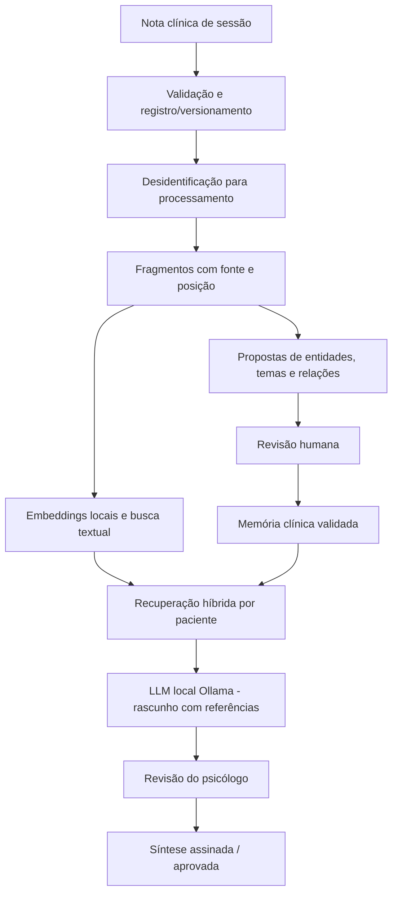

# ADR-001 — Memória Terapêutica Longitudinal Inteligente (MTLI)

**Status:** proposta arquitetural para revisão técnica e clínica  
**Escopo:** módulo de histórico clínico do AELO-PSI (TCC2)  
**Decisão:** implantar um sistema nativo de conhecimento clínico temporal, sem dependência do Obsidian, com recuperação híbrida (RAG + ligações explícitas), proveniência obrigatória e revisão por psicólogo.

## 1. Problema

Prontuários psicológicos são registros narrativos cronológicos. A recuperação de padrões exige relacionar anotações de sessões distantes, mantendo o contexto temporal e a distinção entre relato do paciente, observação do profissional e inferência algorítmica. Uma janela das últimas N sessões não substitui a busca sobre o histórico completo.

O artefato precisa manter as notas originais como fontes de verdade. Resumos, relações entre temas e classificações são derivados e nunca alteram silenciosamente o registro assinado.

## 2. Decisão principal

Implementar três camadas separadas:

1. **Registro clínico:** notas por sessão, autor, versão, assinatura/revisão e retificações, com controle de acesso e criptografia.
2. **Memória derivada:** unidades de evidência, temas, afirmações, vínculos temporais, versões de sínteses e revisões clínicas.
3. **Recuperação e apresentação:** busca textual e vetorial restrita ao paciente autorizado, expansão temporal por relações, síntese citada e visualizações de evolução.

O projeto inspira-se em backlinks/grafos de notas e nas ideias de GraphRAG, mas não inclui Obsidian nem exige a adoção do framework GraphRAG no MVP.

### Diagrama lógico



## 3. Autoaprimoramento: definição e limites

Não é aprendizado autônomo do modelo nem *fine-tuning* contínuo sobre os pacientes.

* **Memória incremental:** a cada nota autorizada o índice é atualizado e novos vínculos podem ser propostos.
* **Aprendizado por correção:** revisões humanas alimentam o estado de memória validada e a avaliação das extrações futuras, sem tornar uma hipótese em fato por repetição.
* **Melhoria de recuperação:** combina embeddings, texto completo, datas, vínculos e feedback de qualidade.
* **Melhoria do processo:** taxa de citações corretas, cobertura de sessões antigas, rejeições e latência orientam ajustes de prompts e ranking versionados.
* **Sem memória transpaciente:** nenhum conhecimento extraído de um paciente é recuperável por contexto de outro. Dados de pesquisa só mediante governança específica, com sintéticos ou datasets legitimamente preparados e protegidos.

## 4. Modelo de dados proposto

Manter as entidades atuais `Clinic`, `User`, `Patient`, `TherapySession`, `ClinicalNote` e `ClinicalNoteHistory`, depois fortalecer versionamento/assinatura.

Novas tabelas ou modelos Django:

| Modelo | Campos essenciais | Função |
|---|---|---|
| `ClinicalNoteChunk` | `clinic_id`, `patient_id`, `note_id`, `note_version`, `span_start`, `span_end`, `text_ciphertext`, `embedding`, `embedding_model`, `index_version` | Índice semântico com âncora no original. |
| `ClinicalMemoryItem` | `clinic_id`, `patient_id`, `kind`, `text_ciphertext`, `source_type`, `occurred_at`, `extracted_at`, `status`, `created_by`, `revision` | Evento/tema/relato/observação/inferência identificáveis. |
| `MemoryEvidence` | `item_id`, `note_id`, `note_version`, `chunk_id`, `span_start`, `span_end` | Evidências verificáveis e navegação à origem. |
| `MemoryRelation` | `clinic_id`, `patient_id`, `from_item_id`, `to_item_id`, `relation_type`, `status` | Ligação temporal ou temática revisável. |
| `MemoryReview` | `item_id`, `reviewed_by`, `decision`, `reason`, `reviewed_at` | Rejeição/aceite/correção humana. |
| `MemorySnapshot` | `patient_id`, `as_of`, `text_ciphertext`, `source_item_ids`, `revision` | Síntese acumulada materializada, não substitutiva. |
| `AIProcessingRun` | `patient_id`, `model_id`, `prompt_version`, `retriever_version`, `run_status`, `source_ids`, `latency_ms` | Reprodutibilidade e auditoria sem registrar PHI em logs. |

**Regras:** toda linha tem escopo de clínica e paciente; impor integridade nas relações por validação de serviço e, quando possível, constraints e políticas de isolamento no banco. Toda memória clínica deve ter fonte, temporalidade e estado de revisão. Registros rejeitados não devem ser reutilizados como evidência. `SUPERSEDED` preserva histórico de correções.

**Tipos de conteúdo:** `PATIENT_REPORT`, `CLINICIAN_OBSERVATION`, `AI_INFERENCE` e `CLINICIAN_VALIDATED` não podem ser confundidos. A relação `PRECEDES`, `RECURS_ON`, `RELATES_TO`, `CONTRASTS_WITH`, `REPORTED_CHANGE` não deve significar causalidade ou diagnóstico. Não criar arestas `CAUSES` a partir de coocorrência textual.

**Temporalidade:** separar a data relatada de um evento (`occurred_at`) da sessão onde foi documentado, da extração automática e da validação.

## 5. Fluxo de processamento

1. Salvar nota como rascunho; profissional controla conteúdo, autoria e vínculo à sessão.
2. Após elegibilidade para análise, executar proteção de dados e desidentificação (NER + regras + avaliação de reidentificação).
3. Fragmentar com offsets, IDs da nota e de versão; gerar embeddings localmente; registrar versão do modelo.
4. Extrair candidatos a temas/eventos/relações com saída tipada; candidatos são `PENDING_REVIEW` e isolados da memória validada.
5. Psicólogo aceita, corrige ou rejeita; registrar decisão sem sobrescrever origem.
6. Criar snapshots incrementais com referências a itens validados; reprocessar somente notas alteradas e dependências, com invalidadores de índice.
7. Em uma pergunta clínica, filtrar por `clinic_id` e `patient_id` **antes** de buscar; buscar tanto informação recente quanto antiga relevante; combinar busca vetorial, textual, recortes cronológicos e relações revisadas.
8. Gerar uma resposta *somente* com evidências recuperadas; para cada afirmação, citar a nota, versão e trecho; declarar informações ausentes ou contraditórias.
9. Exibir resultado como sugestão clínica; profissional decide se aprova a síntese. Não gerar diagnóstico nem avaliação autônoma de risco, nem emitir intervenções automáticas.

Falhas de IA ou banco vetorial devem resultar em estado `FAILED`/indisponível, sem inventar métricas nem respostas de fallback aparentemente clínicas.

## 6. Interfaces previstas

* **Linha do tempo:** sessões, trechos originais e mudanças temáticas, com filtros por período.
* **Mapa temático local do paciente:** relações entre temas, eventos, notas, marcadores de evidência e estado de revisão; sem mostrar ligações com outros pacientes.
* **Painel de preparação pré-sessão:** continuidade de tópicos relatados, perguntas sobre histórico e citações clicáveis.
* **Comparador entre sessões:** quais relatos persistem, mudaram ou entraram em conflito, com diferenciação de fontes.
* **Área de revisão:** lista de relações candidatas, fontes, aceite/rejeição/correção; status visível.
* **Métricas exploratórias:** contagem/recorrência documentada por tema e, após validação empírica, valência textual com intervalos e incertezas. Nunca equivaler sentimento do texto a estado mental, diagnóstico, adesão ou risco clínico.

## 7. Arquitetura no monorepo atual

Preservar Django REST Framework para domínio, autorização, auditoria, registro e revisão; FastAPI para inferência e embeddings locais; React para visualização; PostgreSQL + pgvector para persistência, busca textual e vetorial; Ollama para modelos locais.

Estrutura alvo sugerida:

```text
Backend/
  apps/
    clinical_notes/          # fonte documental e versões
    patient_memory/          # fatos derivados, evidências, relações e revisão
    ai_analysis/             # sínteses assistivas e validações
    patients/                # políticas de acesso por paciente
  services/
    memory/                  # extração, indexação, recuperação e ranking
    security/                # criptografia, desidentificação, auditoria
  ai_service/
    pipelines/               # embeddings, parsing tipado, geração local
Frontend/src/
  features/
    patient-timeline/
    patient-knowledge/
    evidence-review/
    clinical-summary/
docs/
  architecture/
  privacy/
  validation/
```

### Contratos de API (proposta)

* `GET /api/patients/{id}/memory/items/` — tópicos/eventos visíveis, evidências e revisão.
* `GET /api/patients/{id}/memory/timeline/` — trajetória temporal e fontes.
* `GET /api/patients/{id}/memory/graph/` — nós e relações permitidos.
* `POST /api/patients/{id}/memory/reindex/` — ação idempotente/autorizada de reindexação.
* `POST /api/memory/items/{id}/review/` — aprovação/rejeição/correção.
* `POST /api/patients/{id}/analysis/query/` — consulta fundamentada com referências e estados explícitos.

Todas requerem autenticação e autorização objeto-a-objeto no back-end, sem depender das permissões de apresentação do React. Proteções contra BOLA/IDOR e acesso cruzado são critérios de bloqueio de lançamento.

## 8. Segurança, LGPD e conformidade

* Tratamento de dados de saúde: base legal, finalidade, minimização, retenção, direitos dos titulares, gestão de chaves, backup e resposta a incidentes definidos com assessoria jurídica e responsável técnico.
* Não chamar notas sanitizadas de anônimas por padrão: relações narrativas e embeddings podem permitir reidentificação.
* Criptografia de campos sensíveis, chaves fora do código, segregação por clínica e restrição às notas do paciente autorizado; tráfego local protegido, segurança de backups.
* Registro de auditoria de processamento, leitura, revisões, assinatura, exportações e falhas, sem conteúdo de prontuário/prompt bruto nos logs.
* Possibilitar reprocessamento, revogação de índices e destruição controlada de derivados segundo políticas de retenção e direitos legais, sem apagar ilegalmente registros profissionais obrigatórios.
* Aplicar revisão humana exigida pela finalidade clínica. A orientação do CFP de julho/2025 destaca supervisão crítica, sigilo e responsabilidade profissional.
* Implementar mapeamento FHIR documentado: `Patient`, `Encounter`, `DocumentReference`, `Provenance`; `Observation` somente para métricas bem definidas, com interpretação e método descritos. Não alegar certificação FHIR sem validação de perfis.
* Registro obrigatório e critérios de guarda devem ser conferidos à luz das normas profissionais e legislação vigentes.

## 9. Avaliação DSR e critérios de aceite

**Base experimental:** dados sintéticos com temas recorrentes, contradições, mudanças temporais, referências distantes e armadilhas linguísticas, anotados/revisados por profissionais.

**Comparações:** busca manual em prontuários vs RAG vetorial sem links vs memória temporal híbrida.

**Métricas:** 
* recall@k de evidências verdadeiramente relevantes; cobertura de sessões antigas;
* precisão das citações e taxa de afirmações não fundamentadas;
* acerto de vínculos temporais e taxa de relações rejeitadas pelo psicólogo;
* latência p50/p95, falhas e custos de execução local;
* tempo de preparação/revisão pré-sessão e carga administrativa;
* SUS e UMUX-Lite, complementados por observação e medidas de confiança calibrada;
* casos de teste para isolamento de tenant/paciente, permissão, exclusão, retificação e vazamento por logs.

**Critérios mínimos funcionais de MVP:** 100% das sugestões identificadas como não validadas; 100% das alegações de histórico apresentadas com links verificáveis; nenhuma resposta clínica inventada em falha do modelo; nenhum acesso entre pacientes/clínicas em testes de autorização; fontes originais preservadas.

Esses critérios são metas de aceite, não resultados já comprovados.

## 10. Entregas incrementais

As cinco etapas abaixo descrevem **marcos conceituais da MTLI**, não substituem nem renumeram as fases vinculantes **F0–F7** do [Plano Mestre](../PLANO_MESTRE_IMPLEMENTACAO.md). Segurança e registro confiável precedem a indexação; veja F0/F1 do plano mestre.

1. **Marco MTLI-A — Segurança e verdade:** corrigir autorização clínica por paciente/tenant, nota assinada, fallback fictício de IA, scores simulados, tratamento de segredos.
2. **Marco MTLI-B — Memória indexada:** pgvector, chunks ancorados por nota/versão, pesquisa híbrida e resultados com citações.
3. **Marco MTLI-C — Relações e tempo:** eventos, temas, relações e snapshots por paciente, sempre com evidência.
4. **Marco MTLI-D — Revisão clínica:** aceite/rejeição, versionamento derivado, linha temporal e mapa temático.
5. **Marco MTLI-E — Validação:** benchmarks de RAG e sessões SUS/UMUX-Lite com dados sintéticos, análises de usabilidade e limitações.

## 11. Fontes de referência e limites

- Obsidian: [notas conectadas](https://obsidian.md/help/link-notes), [backlinks](https://obsidian.md/help/plugins/backlinks), [grafo](https://obsidian.md/help/plugins/graph).
- Microsoft: [GraphRAG](https://microsoft.github.io/graphrag/) (inspiração, não adoção obrigatória).
- pgvector: [busca por similaridade e híbrida](https://github.com/pgvector/pgvector).
- HL7: [DocumentReference](https://hl7.org/fhir/documentreference.html), [Provenance](https://fhir.hl7.org/fhir/provenance.html), [Observation](https://fhir.hl7.org/fhir/observation.html).
- CFP: [posicionamento sobre IA, julho de 2025](https://site.cfp.org.br/cfp-divulga-posicionamento-sobre-inteligencia-artificial-no-contexto-da-pratica-psicologica/).
- ANPD: [RIPD](https://www.gov.br/anpd/pt-br/canais_atendimento/agente-de-tratamento/relatorio-de-impacto-a-protecao-de-dados-pessoais-ripd) e [conceitos de pseudonimização](https://www.gov.br/anpd/pt-br/documentos-e-publicacoes/glossario-anpd).
- TCC2 de referência: projeto acadêmico fornecido pelo autor, com DSR, IA assistiva, LGPD, FHIR, SUS e UMUX-Lite.

**Nota regulatória:** Resolução CFP 09/2024 trata do exercício profissional mediado por TDICs, e não é uma proibição legal específica de diagnósticos de IA. Esta ADR adota voluntariamente um escopo mais restrito de IA apenas assistiva.
